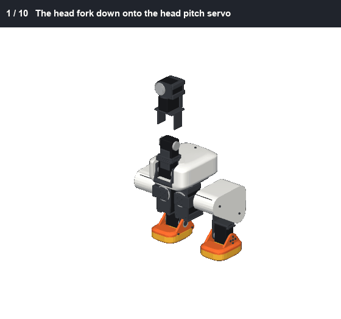

# milli

A small open biped built to look like Pollen Robotics' microduck, from servos you can buy: Feetech STS3215s at the hips and
knees, ROBOTIS Dynamixel XC330s and XL330s at the ankles, neck and head. One Python spec generates the shapes, the checks,
the pictures and the parts list. milli is not made by or connected with Pollen Robotics.



**[Watch the whole build, then milli moving (MP4, 28 s)](docs/images/assembly/milli_build.mp4).** The movement is an
animation from the leg's kinematics, tested for joint limits and collisions. It is not yet a physics simulation or a trained
walk.

## Status

A design, not yet built. Nothing here has been printed or tested on real parts.

- **Size:** 0.317 m tall, 1.38 kg from every part's material (microduck: 0.264 m, 0.8 kg). The STS3215s set the scale;
  the proportions are checked against microduck's at that scale.
- **Joints:** 15, as microduck's: each leg hip yaw, roll, pitch, knee, ankle; neck pitch, head pitch, yaw, roll, beak.
- **Bearings, as microduck's:** a thin bearing round each horn, on the joint's axis, in place of a fork round the servo.
- **Foot switches:** a microswitch in each shoe, as an input to a walking policy, as Open Duck Mini's.
- **Open:** wiring, speaker and microphone, the rod from the beak servo to the jaw, the Fusion model, and a walking
  simulation. The ankle servo is still in question: the XC330 passes the static torque checks with less margin than we'd
  like, and walking is untested.

## Build it

- [Parts to buy](BOM.md): counts generated from the spec. Prices are retailer listings: confirm before ordering.
- [Assembly guide](docs/ASSEMBLY.md): an animation per section, in an order the checks have tested.
- [What went wrong, and the fix for each](LESSONS.md).

## Run it

```bash
python -I spec/robot.py
```

```bash
python -I tools/checks.py
```

```bash
python -I tools/assembly.py
```

```bash
python tools/render_assembly.py
```

```bash
python tools/render_build_video.py
```

`tools/checks.py` covers proportions, mass, collisions over every joint's range, torque and bearing alignment.
`tools/assembly.py` tests the build order: every part can slide in along its path, every screw bites, and a key can reach it.
Python 3.12 with numpy, scipy, trimesh, manifold3d, shapely, Pillow, imageio and mujoco.

## Credits

Forked from [echo](https://github.com/meetsitaram/echo), which is where the method and most of the tools come from. Look
and joint layout measured from [microduck's model](https://github.com/pollen-robotics/microduck_rl) (its meshes are CC BY-NC-SA and are not in this
repo). Servo mounting after the [SO-ARM100](https://github.com/TheRobotStudio/SO-ARM100); servo dynamics and the foot switches after
[Open Duck Mini](https://github.com/apirrone/Open_Duck_Mini). See [THIRD_PARTY_NOTICES.md](THIRD_PARTY_NOTICES.md).

Apache-2.0: see [LICENSE](LICENSE).
