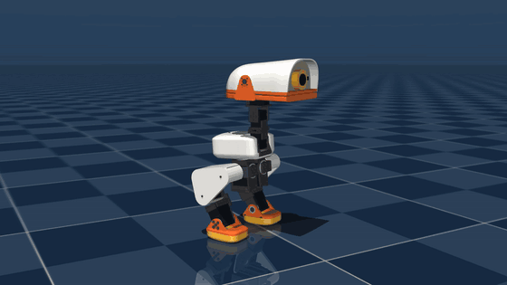
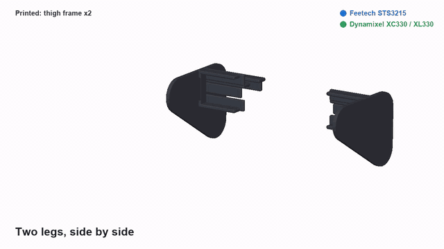

# milli

A small open biped built to look like Pollen Robotics' microduck, from servos you can buy: Feetech STS3215s at the hips,
knees and ankles, ROBOTIS Dynamixel XC330s and XL330s at the neck and head. One Python spec generates the shapes, the checks,
the pictures and the parts list. milli is not made by or connected with Pollen Robotics.



milli under a trained policy in MuJoCo ([MP4, 12 s, sharper](docs/images/walk/milli_walk.mp4)). This is simulation only, part way through
training (iteration 1750 of 3000). It stays up, but told to walk straight at 0.3 m/s, this robot circles, turning about 310 degrees in 10 s.
[Train it yourself](docs/TRAINING.md).



The whole build, then milli moving ([MP4, 28 s, sharper](docs/images/assembly/milli_build.mp4)). The movement in this one is an
animation from the leg's kinematics, tested for joint limits and collisions, not a physics simulation or a trained walk.

## Status

A design, not yet built. Nothing here has been printed or tested on real parts. This branch has STS3215 ankles; branch
`xc330-ankle` keeps the version with Dynamixel XC330 ankles, before the strength and printing work.

- **Size:** 0.321 m tall, 1.51 kg from every part's material (microduck: 0.264 m, 0.8 kg). The STS3215s set the scale;
  the proportions are checked against microduck's at that scale.
- **Joints:** 15, as microduck's: each leg hip yaw, roll, pitch, knee, ankle; neck pitch, head pitch, yaw, roll, beak.
- **Bearings, as microduck's:** a thin bearing round each horn, on the joint's axis, in place of a fork round the servo.
- **Foot switches:** a microswitch in each shoe, as an input to a walking policy, as Open Duck Mini's.
- **Printable parts:** STLs with their screw holes in [prints/](prints/README.md). Strength so far is a hand estimate: print one joint first.
- **Open:** wiring, speaker and microphone, the rod from the beak servo to the jaw, the Fusion model, and a walk that goes
  straight. Walking is in training, in simulation only.

## Build it

- [Parts to buy](BOM.md): counts generated from the spec. Prices are retailer listings: confirm before ordering.
- [Assembly guide](docs/ASSEMBLY.md): an animation per section, in an order the checks have tested.
- [What went wrong, and the fix for each](LESSONS.md).

## Run it

```bash
python -I spec/robot.py
```

```bash
python -I tools/checks.py
```

```bash
python -I tools/assembly.py
```

```bash
python tools/render_assembly.py
```

```bash
python tools/render_build_video.py
```

`tools/checks.py` covers proportions, mass, collisions over every joint's range, torque and bearing alignment.
`tools/assembly.py` tests the build order: every part can slide in along its path, every screw bites, and a key can reach it.
`tools/buildable.py` tests each printed part: one piece, walls, and a load estimate (not FEA). `tools/export_prints.py` writes the STLs. None has been test printed.
Python 3.12 with numpy, scipy, trimesh, manifold3d, shapely, Pillow, imageio and mujoco.

## Credits

Forked from [echo](https://github.com/meetsitaram/echo), which is where the method and most of the tools come from. Look
and joint layout measured from [microduck's model](https://github.com/pollen-robotics/microduck_rl) (its meshes are CC BY-NC-SA and are not in this
repo). Servo mounting after the [SO-ARM100](https://github.com/TheRobotStudio/SO-ARM100); servo dynamics and the foot switches after
[Open Duck Mini](https://github.com/apirrone/Open_Duck_Mini). See [THIRD_PARTY_NOTICES.md](THIRD_PARTY_NOTICES.md).

Apache-2.0: see [LICENSE](LICENSE).
