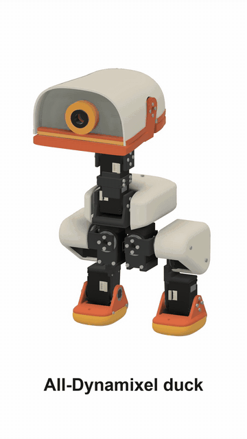

# duck-droids

Open biped robot ducks you can build from servos you can buy, each generated from one Python spec. They take their look from Pollen Robotics' microduck, and aren't made by or connected with Pollen.



**Watch:** [30-second reveal](docs/images/assembly/dynamixel/reveal_30s.mp4) | [5-minute build](docs/images/assembly/dynamixel/build_5min.mp4)

## The all-Dynamixel duck

29.5 cm tall, 0.98 kg, 15 ROBOTIS XL330 servos, a Raspberry Pi Zero 2 W in the head.

| | |
|---|---|
| Parts to buy | [BOM](docs/dynamixel/BOM.md) |
| Files to print | [STLs](prints/dynamixel/README.md) |
| How to build it | [Assembly guide](docs/dynamixel/ASSEMBLY.md), [wiring](docs/dynamixel/WIRING.md) |
| CAD | [Fusion file](cad/duck-droids-dynamixel.f3d) |
| Teach it to walk | [Training](docs/TRAINING.md) |

**Status:** designed and checked in software. Nothing has been printed or built yet, and this version of the design has no trained walk.

## Other ducks

The same design on other servos, and at 1.8 m. Their parts lists and wiring are written and their offline checks pass. None has its latest Fusion model or videos yet.

| Duck | Servos | Size | Parts | Wiring |
|---|---|---|---|---|
| Feetech HD-1910 | 15 HD-1910 | 1.03 kg | [BOM](docs/hd1910/BOM.md) | [Wiring](docs/hd1910/WIRING.md) |
| All Feetech | 15 STS3215 | 37.9 cm, 1.94 kg | [BOM](docs/feetech/BOM.md) | [Wiring](docs/feetech/WIRING.md) |
| Hybrid | STS3215 legs, Dynamixel head | 1.65 kg | [BOM](BOM.md) | [Wiring](docs/WIRING.md) |
| Big: **not safe to build** | 22 RobStride | 1.8 m, 96.8 kg | [BOM](docs/big/BOM.md) | [Wiring](docs/big/WIRING.md) |

More in [the details](docs/DETAILS.md), and [what went wrong along the way](LESSONS.md).

## Run the checks

```bash
MILLI_RECIPE=dynamixel python -I spec/robot.py
```

```bash
MILLI_RECIPE=dynamixel python -I tools/checks.py
```

```bash
MILLI_RECIPE=dynamixel python -I tools/assembly.py
```

Python 3.12 with numpy, scipy, trimesh, manifold3d, shapely, Pillow, imageio and mujoco.

## Credits

Forked from [echo](https://github.com/meetsitaram/echo). Look and joint layout measured from [microduck's model](https://github.com/pollen-robotics/microduck_rl), whose meshes aren't in this repo. Servo mounting after the [SO-ARM100](https://github.com/TheRobotStudio/SO-ARM100), servo dynamics after [Open Duck Mini](https://github.com/apirrone/Open_Duck_Mini). See [THIRD_PARTY_NOTICES.md](THIRD_PARTY_NOTICES.md).

Apache-2.0: see [LICENSE](LICENSE).
