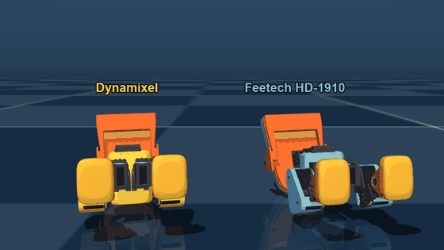
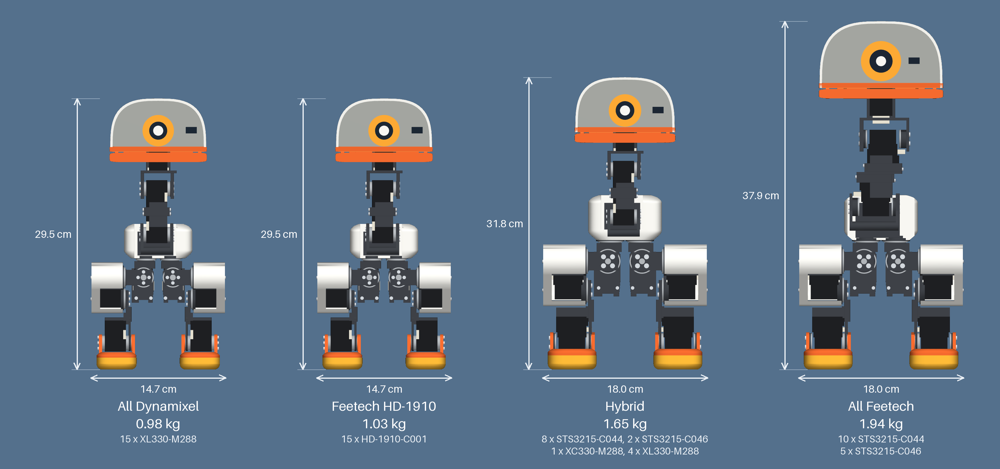
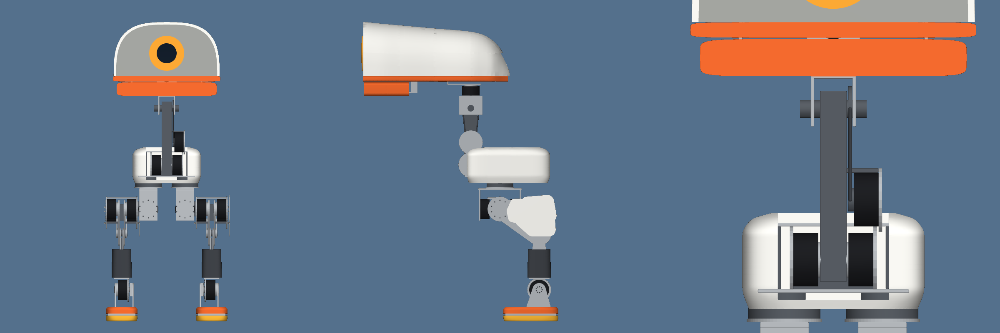
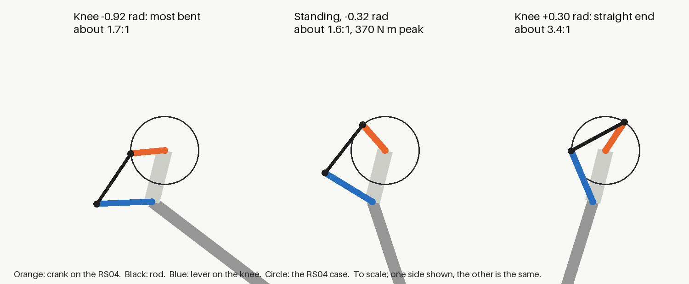

# duck-droids

Open biped robot ducks, from 30 cm to 1.8 m, each generated from one Python spec, and tested in simulation. The first and the most complete is **milli**,
a small open biped built to look like Pollen Robotics' microduck, from servos you can buy: Feetech STS3215s at the hips,
knees and ankles, ROBOTIS Dynamixel XC330s and XL330s at the neck and head. One Python spec generates the shapes, the checks,
the pictures and the parts list. milli is not made by or connected with Pollen Robotics.



The family ([MP4, 17 s, sharper](docs/images/family/duck_family.mp4)). In simulation only: nothing here has been built. Each walk was recorded in physics and replayed at its real speed, told 0.3 m/s (the big duck 0.4). Some of it isn't what it looks like:
the beaks are scripted animation, as the policies keep them shut. Yellow and blue get up with the hybrid's stand-up, not their own. Pink has no trained walk yet and replays the hybrid's, scaled.
The big duck's walk uses a stepping clock, and this one overloads its knee: see [A big duck](#a-big-duck).


An early milli policy in MuJoCo ([MP4, 12 s, sharper](docs/images/walk/milli_walk.mp4)), from iteration 1750 of 3000, before the fixes in
[LESSONS.md](LESSONS.md): it circles. The finished walks go straight: see the table below. Simulation only. [Train it yourself](docs/TRAINING.md).


The whole build, then milli moving ([MP4, 28 s, sharper](docs/images/assembly/milli_build.mp4)). The movement in this one is an
animation from the leg's kinematics, tested for joint limits and collisions, not a physics simulation or a trained walk.

## Four servo recipes

One design on four sets of servos, drawn at the same scale, to compare in simulation on walking, the head roll and getting up after a
fall. A case study you can rerun or add to: pick one with `MILLI_RECIPE`, or add your own to `RECIPES` in [spec/robot.py](spec/robot.py).



Microduck, for scale: 26.4 cm tall, 14.1 cm wide on its model, 0.8 kg as published, on XL330s.

- **Nothing here has been built or tested on real parts.** Hybrid is the design the rest of this README, the parts list and the printable
  files describe. All Dynamixel has its own [parts list](docs/dynamixel/BOM.md), [printable files](prints/dynamixel/README.md) and [CAD](cad/duck-droids-dynamixel.f3d), but changed after its walks were trained. The other two are spec-only drafts.
- **All Dynamixel** runs its XL330s straight off a 2S pack, as microduck's trainer models its own, which is past ROBOTIS's 6 V maximum. Its
  torque and speed at that voltage are estimates.
- **Feetech HD-1910** is the servo most community Microduck builds use, and is rated to 8.4 V, so it stays inside the maker's limits. Its numbers are a seller's sheet (+/- 10 %; the maker's own lists less torque), and its motor friction and inertia, and position gain, are estimates. No part of those builds is used here.
- **All Feetech** passes its checks only with looser limits, set in the spec: a higher mass budget, proportions within 15 % rather than 10 %, a
  smaller head roll range, and one pose (the floor pick) it can't reach.
- Masses are estimates from each part's material. Pictures: `python tools/render_recipes.py`.

Results so far, in simulation only, from 64 robots with the training's randomization on. Speeds are what they reached:

| Walk, final checkpoint (3000) | Told 0.1 / 0.2 / 0.3 / 0.4 m/s forward | Backward 0.2 | Sideways 0.2 | Turn 1.0 rad/s |
|---|---|---|---|---|
| Hybrid | 0.10 / 0.19 / 0.26 / 0.31 | 0.11 | 0.06 | 0.94 |
| All Dynamixel | 0.00 / 0.16 / 0.22 / 0.25 | 0.00 | | 0.98 |
| Feetech HD-1910 | 0.05 / 0.16 / 0.24 / 0.33 | 0.14 | 0.06 | 0.92 |
| All Feetech | not trained yet | | | |

- **All Dynamixel** freezes at the slowest speed and doesn't go backward.
- **Getting up:** the hybrid, at iteration 3000 of a stopped run, gets up 100 % of the time from face down, face up and sitting, but in 0.2-0.55 s, too
  fast to trust on real servos, with small overlaps in 4-5 of 200 frames. The other recipes aren't trained on it yet.
- **The head roll:** set aside. No policy does it: all Dynamixel, the only recipe that reached 3000 iterations on it, turned 35 degrees at best. Scripted
  searches (`tools/flip_search.py`) didn't get a clean flip either.

## A big duck

The same duck at 1.8 m, taller than [echo](https://github.com/meetsitaram/echo), on RobStride RS04 actuators, to test whether the method scales: a full design first, with
metal frames, bearings, screws and printed panels that fit a 256 mm bed, from its own spec, [spec/big_duck.py](spec/big_duck.py) (`MILLI_RECIPE=big`).





- **Size:** 1.797 m tall, 99.5 kg from every part's material, 23 actuators (20 RS04, 2 RS03, 1 RS00). Masses lean on assumed pocketing: no pockets are drawn.
- **Knee:** two RS04s, each with a crank, a rod and a lever, in place of a roller chain. 1.54:1 at its weakest, about 3.4:1 at the straight end, over 70 degrees.
- **Given up:** deep squat and floor pick, as the crank's range won't reach them; the head roll, for a lighter neck.
- **Strength against real humanoids,** peak torque over (weight x leg length), read from their own URDFs: knee 0.56 and hips 0.36 are in the range of
  Unitree's G1, H1-2 and H2 and AgiBot's X2 and A3 (0.35-0.65), and ankle 0.18 is above Unitree's. Hip yaw, 0.18, is about half most of theirs, and it has no ankle roll, which they all do.

**Can it walk?** Slowly, in simulation. All of this needs help the small ducks didn't: a stepping clock. Scaled correctly, with no clock, it learned to stand still.
- [The walk in this video](docs/images/big/big_walk.mp4) (MP4, 8 s) reaches about 0.33 m/s told 0.4, but overloads its knee: 170 N m RMS against 123 rated.
- With a penalty for sustained overload, at iteration 1500 of 3000, every joint is under its rating at 0.3-0.4 m/s (knee 99 N m), on a straighter leg, and all 32 test robots stay up.
  The cost is speed: 0.20 m/s told 0.4, 0.04 m/s backward told 0.2. It drifts sideways at about 0.12 m/s whatever it's told, and barely answers sideways commands. That run wasn't finished when this was written.
- Not done: stress analysis, the RS04's real drawing, the chain's tensioner, the rods moving in the model, wiring, how it survives a fall, the Fusion model.

## Status

A design, not yet built. Nothing here has been printed or tested on real parts. Fusion models so far: hybrid and [all Dynamixel](docs/dynamixel/BOM.md), in [cad/](cad/). milli has STS3215 ankles; branch
`xc330-ankle` keeps the version with Dynamixel XC330 ankles, before the strength and printing work.

- **Size:** 0.321 m tall, 1.59 kg from every part's material (microduck: 0.264 m, 0.8 kg). The STS3215s set the scale;
  the proportions are checked against microduck's at that scale.
- **Joints:** 15, as microduck's: each leg hip yaw, roll, pitch, knee, ankle; neck pitch, head pitch, yaw, roll, beak.
- **Bearings, as microduck's:** a thin bearing round each horn, on the joint's axis, in place of a fork round the servo.
- **Foot switches:** a microswitch in each shoe, as an input to a walking policy, as Open Duck Mini's.
- **The Fusion model:** built from the spec, one body per printed part with its holes and pockets, 15 joints, each part checked point by point against its STL: [cad/duck-droids-hybrid.f3d](cad/duck-droids-hybrid.f3d), [.step](cad/duck-droids-hybrid.step), [picture](docs/images/fusion/fusion_34.png). The build video above is from before this round.
- **Printable parts:** STLs with their screw holes and pockets in [prints/](prints/README.md), left and right, turned the way they should print. Strength so far is a hand estimate: print one joint first.
- **Head limits:** head roll over 0.1 rad only while head yaw is under 0.5 rad, or the head meets the yaw servo. The head pitch XL330 can pass through, but not hold, the head forward and down.
- **Open:** a power switch, speaker and microphone, and retraining: the servo cases are 3 mm thinner than the walks were trained on, the model 90 g heavier, with wider thighs.

## Build it

- [Parts to buy](BOM.md): counts generated from the spec. Prices are retailer listings: confirm before ordering.
- [Assembly guide](docs/ASSEMBLY.md): an animation per section, in an order the checks have tested.
- [Wiring](docs/WIRING.md): power rails, buses, and where each cable goes.
- [What went wrong, and the fix for each](LESSONS.md).

## Run it

```bash
python -I spec/robot.py
```

```bash
python -I tools/checks.py
```

```bash
python -I tools/assembly.py
```

```bash
python tools/render_assembly.py
```

```bash
python tools/render_build_video.py
```

`tools/checks.py` covers proportions, mass, collisions over every joint's range, torque and bearing alignment.
`tools/assembly.py` tests the build order: every part can slide in along its path, every screw bites, and a key can reach it.
`tools/buildable.py` tests each printed part: one piece, walls, and a load estimate (not FEA). `tools/printable.py` tests the exported parts: orientation, supports, and that they fit each other.
`tools/beak_linkage.py` solves the beak's drive through its range. `tools/export_prints.py` writes the STLs. None has been test printed.
Python 3.12 with numpy, scipy, trimesh, manifold3d, shapely, Pillow, imageio and mujoco.

## Credits

Forked from [echo](https://github.com/meetsitaram/echo), which is where the method and most of the tools come from. Look
and joint layout measured from [microduck's model](https://github.com/pollen-robotics/microduck_rl) (its meshes are CC BY-NC-SA and are not in this
repo). Servo mounting after the [SO-ARM100](https://github.com/TheRobotStudio/SO-ARM100); servo dynamics and the foot switches after
[Open Duck Mini](https://github.com/apirrone/Open_Duck_Mini). See [THIRD_PARTY_NOTICES.md](THIRD_PARTY_NOTICES.md).

Apache-2.0: see [LICENSE](LICENSE).
