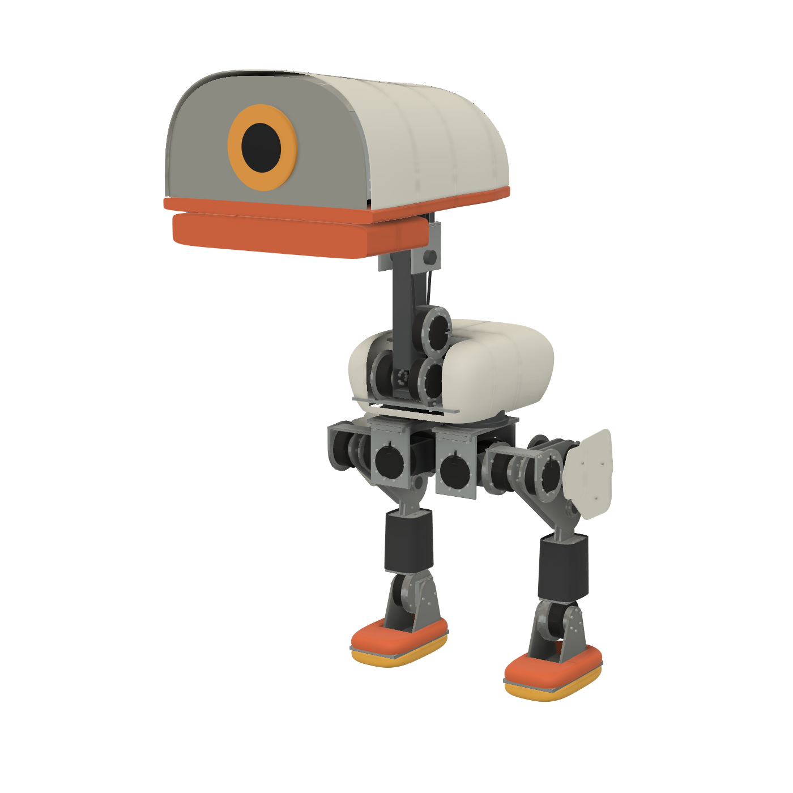

# Big duck in Fusion

**NOT SAFE TO BUILD.** A model that builds in Fusion says nothing about strength. Clash checks test whether shapes overlap, not whether a frame holds: see [Open before ordering](BOM.md#open-before-ordering). Fit is what this page checked. Strength wasn't checked at all.

The actuators are now RobStride's own models. Those files have no licence, so they stay on this machine, in `%TEMP%/figrefs/robstride` (`python -I tools/fetch_servo_cad.py`), and in the private hub documents in my-projects / duck-droids / big. They're not in the repo, and there's no `cad/duck-droids-big` export.

## What the files say

Read in Fusion, by its bounding box and point-in-solid scans, and from the files' own circles. All in mm, and each file says mm. In each, the axis is z through the origin. The RS04's output faces +z; the RS03's and RS00's face -z. No file holds a mass, so 1.42 kg can't be checked. The numbers are in `RS` in `spec/big_duck.py`.

| RS04 | Spec had, or manual says | The file |
|---|---|---|
| Overall | a 120 x 56 cylinder | 120 x 55.7, z -27.2 to +28.5 |
| Case | | 120 across, z -14 to +25, 39 long, as the manual says |
| Rear step | manual: 94 x 13.2 | 94 x 13.2, as the manual says. A flat and a slot in it |
| Output face | manual: 0.5 past the stator | a ring r 12.5-25 at z +25.5, 0.5 past the stator's face (r 30.25-60) at +25 |
| Pins | manual: 3 x 6 on 35.86, standing 3.3 | 3 x 6 on 35.86, tips at 28.5: **standing 3.0** |
| Output screws | M5 x 9 on 36; manual: **6.5 deep** | M5 x 9 on 36, 12 places less the 3 pins' (not 9 equal). **Blind at z +22: 3.5 deep.** 6.5 is floor to pin tip |
| Mount screws | 10 M4 on 106, 5 and 6 deep | 10 M4 on 106: 7 deep at the front (5 by the manual) and 6 at the shoulder |
| Cable | "out of the side of the rear step" | a 7.3 sleeve, radial, angle 75, z -20.3, ending at r 58.1 |

| RS03 | Spec had | The file |
|---|---|---|
| Overall | a 106 x 56 cylinder | 56.6 long. Body 92.8 across, 8 lobes to 106.6 |
| Rear step | none | 79.5 across, 14.6 long, from z 42 |
| Output | | r 35, 2.5 past the stator |
| Mount screws | 8 M4 on 98 | 8 M4 on 98 at the front. **Only 4 free at the rear:** RobStride's own cap screws fill the other 4, standing 4 mm past the face |
| Output screws | 6 M4 on 30.36, 6 deep | 6 M4 on 30.36, 9 deep |
| Pins | 3 x 4 holes | 3 x 4 holes, 7 deep: no pins of its own |
| Plugs | not read | on the rear step's sides, at z 53, facing +-x |

**RS00:** 57 x 52.1, one piece with its 2 sockets. Its mount is drawn but its beak drive isn't designed.

The power board and hub: [wiring](WIRING.md#the-boards-from-their-step-files).

## What changed in the design

- **Every stator hangs by its shoulder.** Plates that lay on a rear face had nothing flat to lie on. A plate now sits on the 13.2 mm step's shoulder, with a 95 mm bore, 10 M4 x 12 and a closed window for the cable. The step stands 5.2 mm past the plate. So the leg's outer plates moved in 16.7 mm, and thigh covers stand 15 mm off them, for the cable.
- **Stators turn to match the plates.** Each cable points along an axis. Both hole patterns are symmetric about the cable, so a right-hand actuator, turned 180 deg about its cable, has its holes where the left's mirror lands. Fusion places them that way: rotation only, never a mirror. The rotor's zero is set in software to suit.
- **The hip yaw is new.** It was a bearing round the case's own 120 mm, on a sleeve the case left no room for. Now a fixed housing hangs from the deck round the stator, holding the bearing's outer ring below it. The inner ring is on the output's flange. The leg's moment goes housing to deck, and only torque goes through the actuator. Its cable comes out above the deck, in the body.
- **Every output has a flange**, with holes for pins and counterbored screws sized to engage 3 mm of thread: M5 x 8 on the cranks, x 10 on hip pitch (low heads) and ankle, x 12 on hip yaw and neck, x 18 on the roll yoke, which is hollow so a key can reach them. Plates bolt to flanges by a second circle of screws, so they go in after: 16 mm screws fit in the thigh's 24 mm. The hip pitch's old M5 x 16 through 20.5, the ankle's x 20 through 20, the roll's 8 deep into 6.5 and the yaw's heads in a 2 mm gap are gone.
  **The user's decision (2026-11-05), until a real RS04 is measured:** design for the 3.5 mm thread the STEP file shows, the conservative case. Each output screw engages about 3 mm and never reaches the bottom of its hole, and the 3 pins are taken to carry the torque, the screws only to hold the flange on.
- **The knee's four-bar didn't close.** Giving the rods their motion showed it: at 106 mm the rod can't reach below knee -0.74, probably since the hip moved after that sweep: a comment still had it 40 mm lower. Now the same crank and lever, with a 148 mm rod and the lever at 150 deg, closes from -0.92 to +0.30. Ratio: 1.54 at its weakest and 1.89 bent, as before; 2.56 at the straight end, not 3.35. The walks use the first two.
- **Rods have holes and bushes**, 14 x 10, on 10 mm pins, and cranks and rods are their own parts.
- **RS03s.** Each rear plate has 4 screws and 4 clearance holes for RobStride's cap screws. The bridge and cradle moved 14 mm, as its output is nearer its shoulder than the old cylinder's end, so the head didn't move.
- **Smaller:** the hip roll cheeks are wider, 132 mm, as a 110 mm plate left 2 mm beside its screws. Front body posts moved off the yaw stators' steps. The computer's box stands 6 mm off the deck, over them. The neck spine has a window for its screws' key. Head pitch shaft, knee shaft and pins have bores.

## The closed loop

The knee's four-bar can't be a tree of joints, and the trainer's model needs a tree. So the spec keeps one knee joint. Its cranks and rods are drawn in the thigh's link at knee 0, tagged with a `group`, and `spec['mech']` holds their joints and their angles at 13 knee angles. In the Fusion assembly each is its own part, on a revolute joint: crank to thigh, rod to crank. **The rod's far end isn't jointed to the lever, so Fusion's model doesn't drive the knee.** Moving the knee there leaves the rods behind.

What checks that it closes is `tools/big_sweep.py`, offline, on the spec's stepped shapes: left knee, 13 angles, cranks and rods against the thigh, shin and each other: 0 clashes. Flip the rod's angle and it reports 10, so it can fail.

**Not proven in Fusion.** I tried the same in Fusion with the real RS04s, and it passed with the rod's angle flipped too, so that test proved nothing, and I removed it. Joints set from the API moved occurrences' boxes after `computeAll`, but neither `analyzeInterference` nor saved pictures followed. So every Fusion picture and clash here is at the zero pose.

## How long it takes

| | Big duck, stand-ins | Big duck, real actuators |
|---|---|---|
| Moving parts in the assembly | 16 | 24 |
| Links built and saved | 281-351 s | **about 430 s, 95 s of it reading the RS04 once** |
| The assembly's refresh, 23 joints, clash check, pictures | 53 s | 130-147 s |
| Crop pictures, 72 | | 30 s |

## Joints

All 23 took 98 % of both limits with none refused. That's Fusion's joint limits, read back as numbers: nothing checks what hits what on the way.

## Clashes

**41**, at the zero pose (2026-11-05, after the frame joints), down from 266 before them and 353 on the first build with real shapes. `reports/fusion_interference_big.json`, boxes in `reports/fusion_clash_boxes_big.json`. Each was read by type and link.

**Against the real actuators: 0. Metal against metal: 0. A screw in metal: 0.** Screws are drawn at their core diameter, so each would clash if it missed its tap hole, ran too long, or met another. The first build of this round found 64 such, all one drawing fault: a countersunk screw's shank drawn through its own head. Fixed in `screws()`, and with it 12 foot screws' heads standing in the solid soles, which now have pockets.

| Where | Types | Count | Largest | Meaning |
|---|---|---|---|---|
| across the head pitch | chain and 25T sprocket | 2 | 0.58 cm3 each strand | a chain drawn as 2 straight bars tangent to the pitch circle. Chain and tensioner aren't designed |
| inside the neck | chain and 13T sprocket | 2 | 0.23 cm3 | the same drawing |
| inside the head and trunk | panel and metal | 16 | head rail in a bill panel, 7.8 cm3; deck in the front body panels, 1.3 cm3 | panels have no reliefs for the frame |
| inside the head | panel and screw | 16 | beak mount and rail screws in the bill panels | the same |
| inside the head | panel and panel | 5 | eye ring in eye lens, 113 cm3 | the eye is solid discs |

Before this round, 148 metal-and-metal, 23 metal-and-steel, 24 bearing and 7 box clashes were the 0.5 mm overlaps with nothing holding them, and press-fit bores drawn under size. Parts now meet face to face (Fusion leaves coincident faces out), and fits are drawn at nominal size and named in `HELD`.

## Frame joints (2026-11-05)

Before this, every part that touched another in a link was drawn 0.5 mm into it, so the offline checks would read the link as one piece, and nothing held them together. Now parts meet face to face, and each pair that touches shares a screw or a joint named in `HELD` in `spec/big_duck.py` (a fit, a key, a strap). Each screw says what it clamps and what it threads into. [ASSEMBLY.md](ASSEMBLY.md) has the order and the screw table, from `tools/big_assembly.py`.

| Where | How |
|---|---|
| Deck to posts, upper plate | M5 into each end of a tapped square bar |
| Neck plates | a tie between them, 2 M5 each, up through the deck; a cleat outside each at the front. Their feet cut flat on the deck |
| Hip yaw | a flange on the housing's foot, 8 countersunk M4 for the retainer; the inner retainer 6 thick, 8 M4 up through the yaw flange; deck widened round each housing |
| Hip roll cheeks | each hangs from the beam by a cleat outside it: 3 M5 up into the beam, 2 through the cheek |
| Hip roll yoke | the ring to the inner upright is machined with it; 5 M5 through the upright into the ring; a slot in the ring for the stator's cable |
| Hip pitch uprights and bridge | ribs are in the uprights now; M4 through each upright into the bridge's ends |
| Thigh | countersunk M5 into the spacers, flush under the cranks and rods; ties tapped both ends, moved to clear the knee stators |
| Knee | the shaft keyed to levers and hubs; the hubs stand on the shin's top, bolted through a spacer (they ran through it) |
| Shin | a folded 6061 tube, welded seam; a top plug and a cap, M4 through the walls; the ankle's three plates through-bolted and hung from the cap |
| Foot | ears flat on the plate, M4 from below; shoe pieces on M4 into inserts; soles bonded |
| Neck, head pitch | a 40 mm tie with 3 M5 x 80 into the spine; yokes under the bridge, M4 down |
| Head | rails through notches in the main frame, M4 sideways; frames on their ends; lugs and beak mount on the rails |
| RS03s | each uses its 8 front holes too, through a ring and 4 posts to the plate behind it |
| Rods | E-clips (DIN 6799, 8) past each rod, both lanes 2.5 mm wider for them |

The checker's numbers, at the zero pose: 287 parts, 743 screws, 249 steps, 1531 checks, **0 failing**; 174 warnings, all printed panels. It fails on purpose when a screw's joins are dropped, two steps are swapped, a part's way is reversed or a screw is shortened (`--bad join|order|way|bite`). What it found along the way: an inner retainer only reachable after the stator that hides its screws, the yaw housing's outer screws 11 mm off the deck (since the first build), screws under the neck tie's heads and the computer's box, two pairs of screws meeting head to head across the thigh, cleat screws under the ankle stator, and ties 0.6 cm3 into the knee stators.

## What's still not buildable

- **Frame joints are designed for fit, not strength.** See [Frame joints](#frame-joints-2026-11-05). Many are M4 tapped into the edge of 8 mm plate; the head pitch stator plate hangs from one tie; the head roll cradle stands on 3 M4 into its edge. Nobody has checked any of them carries its load.
- **Rods: retained, not sized.** E-clips on each pin now, with room for them. A 5 mm rod with a 4 mm wall around its bush takes 2-4 kN, unchecked.
- **Panels have no fixings:** body, hood, face, bill, beak, shin. They touch the frame, some cut into it, and nothing holds them. Keyways for the knee and head pitch shafts are named, not drawn.
- **Solid parts with assumed fill:** the yoke, spine and beam. Their pockets may take what they need.
- **The 13T sprocket** has a plain face for 9 M5 and 3 pins. A bought one doesn't. The chain and tensioner aren't designed.
- **The beak's drive** isn't designed. The head's boxes are placeholders.
- **Cables don't reach.** Listed, not drawn, in [CABLES.md](CABLES.md): at least 14 of 22 harnesses are too short for the boards on the deck. Each leg needs its own CAN hub and power block, or extensions. Neither is designed.

## What the pictures show

**2026-11-05, after the frame joints:** 96 crops now, the 12 joints and 4 on the right leg (`r_hip_roll`, `r_hip_pitch`, `r_knee`, `r_ankle`), skin hidden, zero pose. Looked at as contact sheets: hip roll (the cleats under the beam, the cheek screws), knee stators (ties, cover posts), knee (hubs on the shin's top, its spacer), ankle (the cap, its cleats, the ankle plates' through-bolts), head yaw (the RS03's front ring and posts), and the right hip roll, which matches the left with its actuators turned. And offline, from the spec's shapes in MuJoCo, one bent pose (hip pitch -0.9, knee -0.92, ankle +0.6, roll +-0.2), from the side, three-quarter, front and back with the skin hidden: nothing visibly crossing. Not looked at this round: the hip yaw, hip pitch, neck, head pitch, head roll, beak and right knee and ankle sheets, the `links/` pictures, and any bent pose in Fusion.

Before that: `docs/images/fusion/big/crops/`, 72 close crops, 12 joints from 6 sides each, on the left and in the middle, skin hidden, at the zero pose, as 12 contact sheets, 500 px a view. Whole robot from three-quarter. The rods only with the outer rear plate hidden, at the zero pose, where they run from crank pin to lever pin as drawn.

- **Hips and knee stators:** real cases on real plates, each with its window and cable sleeve. Hull plates show as 24-sided polygons, a drawing limit.
- **Hip yaw:** a plain drum from outside. Bearing and flange can't be seen in it, and I didn't cut a section to look.
- **Hip roll:** the hollow yoke's screws are visible through it.
- **Neck:** bosses and heads through the window. The spine is still a plain bar.
- **Head yaw and roll:** lobed RS03s with RobStride's cap screws through their holes. Plugs clear of the plates.
- **Ankle:** real case, ring and two plates, 6 ear screws. The shin stops 2 mm over the case.
- **Beak:** the RS00 lies on its mount by a line. A placeholder.

Not looked at then: the right leg (the left's mirror in the spec, and the same actuators turned), any other pose in Fusion, `links/` pictures one by one, and `back`, `side`, `under` and `top` of this build.

## Not done

- A one-document build, `.f3d`, `.step`, videos. An export would hold RobStride's models: that's the user's call, and it waits on their licence.
- Measuring a real actuator, the thing the thread question needs.
- The old `big assembly` document, with stand-in actuators' joints, is still in the hub, stale. This build's is `big assembly real`. Deleting one is for the user.
