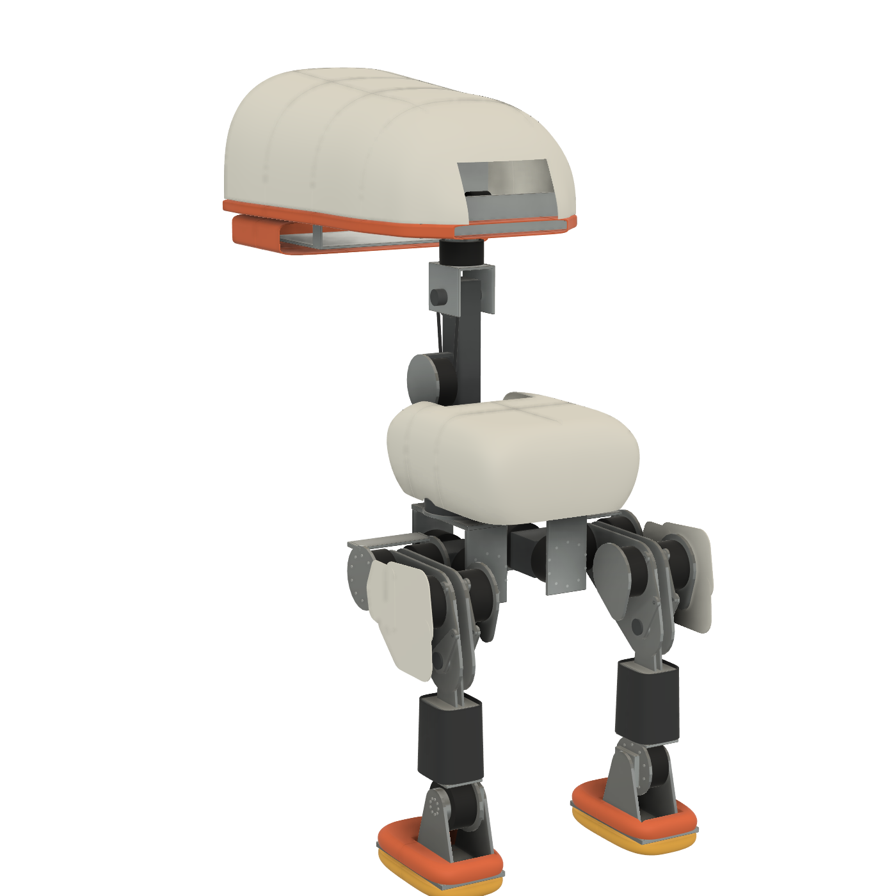

# Big duck in Fusion

**NOT SAFE TO BUILD.** A model that builds in Fusion says nothing about strength. Clash checks test whether shapes overlap, not whether a frame holds: see [Open before ordering](BOM.md#open-before-ordering).

The actuators are stand-ins: plain cylinders, as RobStride's STEP files haven't been downloaded. So this model can't show the real cases, cables or pins. The panels are 3 mm hollow lofts with no fixings, and the frames have no holes or pockets.

## How long it takes

Fusion's time goes with features, not metres, and the big duck has fewer than a small one.

| | All Dynamixel | Big duck |
|---|---|---|
| Links | 16 | 16 |
| Bodies | 514 | about 500 |
| Printed parts joined and rounded | 43 | 0 |
| Holes and pockets cut | 404 and 117 | 0 |
| Lofts, and the plane cuts on them | 10 and 3 | 54 and 206 |
| Links built and saved | about 9 min, assembly included | **281 s** in the first run, 351 s in the second with pictures of each link |

In the first run, by link, in seconds: head 176, trunk 36, beak 12.5, and each of the other 13 under 6. The head is the cost: 30 hood panels, each a loft cut by up to 5 planes. The assembly's refresh, joints, clash check and pictures take 53 s.

It's quick partly because its frames have no holes, pockets or fixings. Adding them will cost what they cost the small ducks.

## The hang

The first full build held Fusion for 25 minutes past its turn: links, clashes and pictures were done 6 minutes in, and the call never returned. It wasn't this duck's size or its assembly. The coordinator traced it to `close_all` in `linked_build.py`, which looped forever on a link that refused to close, and it stopped the hybrid's assembly the same way. It's now bounded, and the assembly has since run and closed twice.

## Joints

All 15 moved to 98 % of both limits with none refused. That's Fusion's joint limits only: nothing checks what hits what on the way.

## Clashes

342, at the zero pose, in `reports/fusion_interference_big.json`. All read by type and link: 336 are inside one link, 6 cross a joint.

### Across a joint, where a clash is a real flaw

| Clash | What it is | Done |
|---|---|---|
| Knee rod into lever pin, 0.39 cm3, 4 of them | the rod has no hole drawn. It's drawn at knee angle 0 and belongs to the thigh, as one body can't swing within a link | **not fixed:** the rods need their own moving links, and bushes |
| Chain into 25T sprocket, 0.58 cm3 each strand, 2 of them | a chain drawn as 2 straight bars tangent to the pitch circle | a drawing, not a flaw. Chain and tensioner aren't designed |

Fixed since the first build, which had 22:

- **Inner thigh covers into the rear hip roll actuator (8.4 cm3), yoke, cheek and seat.** All inner covers are gone, as the sweep below found the rest failing too. **The cost: the frame shows from the inside of each thigh.**
- **Body panel into the hip yaw drum (0.41 cm3).** A round clearance is cut in the panel.

**Sweeps.** `tools/big_sweep.py` swings the 3 outer covers and their posts through the hip pitch's whole range, at 21 angles, against everything above that joint, with the other joints at zero: 0 clashes. **Still untested: hip pitch and roll moving together, covers against the knee and shin, and the rods.**

### Inside one link, which are not assemblies

Within a link everything is one rigid lump in the model, and these overlaps say that **no joint between those two parts has been designed.** None of them can be built as drawn, and none has been fixed.

| Types | Count | Largest | Meaning |
|---|---|---|---|
| metal and metal | 133 | neck output in the solid neck spine, 30 cm3 | plates running into blocks, with no fastening or pocket |
| panel and metal | 42 | foot plate in the sole, 13.6 cm3 | panels have no pockets for what they meet |
| metal and screw | 38 | 0.08 cm3 each | no screw holes are cut |
| seat and metal or actuator | 58 | 5.8 cm3 | the thin rings the spec adds so the checks read touching parts as one |
| steel and metal | 24 | head pitch shaft in its yoke, 10 cm3 | shafts through plates with no bores |
| panel and panel | 11 | eye ring in eye lens, 113 cm3; thigh cover pieces, 33 cm3 | the eye is solid discs; cover pieces overlap, instead of meeting at a seam |
| bearing and metal | 10 | hip yaw outer race in its drum, 1.9 cm3 | no seats cut |
| bearing seat and shaft | 8 | 0.08 cm3 | races drawn a hair inside the bore |
| battery or board and metal, or screw | 8 | battery in deck, 11 cm3 | the box overlaps the plate by 0.5 mm, so they read as joined. Deck screws run up into the computer box |
| steel and steel | 3 | shaft in sprocket, 10 cm3 | no bore; a chain drawn tangent |
| actuator and metal | 1 | beak actuator in its mount, 0.18 cm3 | a placeholder: the beak's drive isn't designed |

## What the pictures show

The whole robot from the back, and before the inner covers went from the front three-quarter, side and below. Each link on its own from 3 sides, in `docs/images/fusion/big/links/`: the left leg's and the middle links'. The right leg is the left's mirror by the spec's code, and wasn't looked at. These were read small, on contact sheets, not as close crops at each joint, and no other pose was looked at. The trunk's picture has since been retaken with the battery moved, and that new one hasn't been looked at.

- **Trunk:** the panels are hollow, and the drum clearance and neck slot are open. The blue battery shows through the slot.
- **Hip yaw link:** rectangular cheeks with screws showing, holding 2 actuators by their faces alone.
- **Hip roll link:** a solid block for a yoke, with a plain disc on its face. A placeholder, as the block's fill is assumed.
- **Thigh:** outer covers stand off on thin posts and look like loose flat plates. Nothing joins them, and the inner frame is bare now.
- **Shin:** a plain dark box, the cover over its walls.
- **Foot:** the plate's edge shows between shoe and sole, and the ears stand in an open rectangle in the shoe.
- **Neck:** one solid bar, with 2 thin bars for a chain. Plainly unfinished.
- **Head:** from behind, a square opening in the hood looks onto its frames and the beak actuator. **Not fixed:** a closing panel went through that actuator, and the offline check caught it, so I took it out again. It needs the beak's drive designed first. From the front, a gap runs round the face panel, and light came through it from that opening.
- **Jaw:** hollow, on a sheet frame, its hinges 2 plain tabs.
- **Whole robot:** the head hangs 0.6 m in front of the neck, and the hip frame sits below the body with a gap. Nothing here is checked for strength or a fall.

## Not done

- The real RS04, RS03 and RS00 shapes: that needs RobStride's STEP files, which is the user's call.
- A one-document build for `cad/duck-droids-big.f3d` and `.step`. The hub's documents, in my-projects / duck-droids / big, are the only model so far.
- Videos, which need that build.
