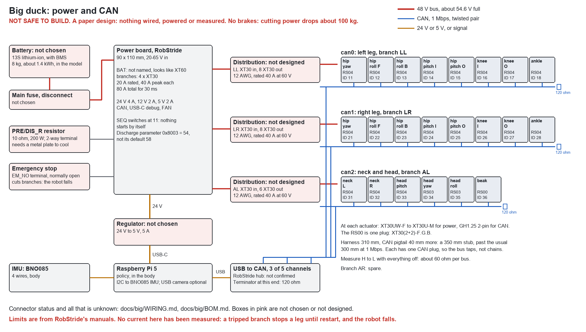

# Wiring the big duck

**NOT SAFE TO BUILD.** This is a paper design for about 100 kg of robot on a 48 V bus: nothing here has been wired, powered or measured. Every current below is a limit from a data sheet, never a measurement. The motors have no brakes, so anything that cuts their power drops the robot. See [Open before ordering](BOM.md#open-before-ordering).

The picture is drawn by `python -I tools/big_wiring.py`, from the 22 actuators in `spec/robot_big.json`. Connector names are from RobStride's manuals for the RS04 (260713), RS03 (261013), RS00 (260713) and power board (V1.3), read as text and figures on 2026-11-05. Where a manual doesn't name a connector, the table says so.

## Every connector

| Where | Connector | Status |
|---|---|---|
| Battery output | the candidate pack has no connector: to match the power board's input, below | candidate only; see [its options](BOM.md#battery-options) |
| Power board input, "BAT" | an AMASS-style right-angle socket, 7 mm between its pins off the board drawing, so probably XT60PW | **not named in the manual, nor in `POWER_PCB_V1.3_1105.step`**, where it's an unnamed solid, 18 x 16 x 11 mm, on the board's left edge. Read a real board. An XT60 is less than the board's 80 A software limit: check it isn't the limit |
| Precharge and discharge resistor, "PRE/DIS_R" | 2-way screw terminal | the board won't start without the resistor: 3-10 ohm, 50 W or more |
| Motor branches x 4, "M+" | XT30 right-angle sockets, 5 mm between pins | as drawn; not named in the manual |
| 24 V, 12 V, 5 V rails | 2-pin sockets, one each | **type not named** |
| Emergency stop, "EM_NO" | 2-way screw terminal, blue | normally open by default |
| CAN, "CAN", H and L marked | 2-pin socket, white | **type not named** |
| Fan, "FAN" | X2510WRS-04-9TSN on early boards, standard PC fan on V1.3 | named |
| Debug | USB-C | named |
| RS04, RS03, power on the case | AMASS XT30APW-M; line end AMASS XT30UW-F | named |
| RS04, RS03, CAN on the case | GH1.25-2PWT; line end GH1.25 2-pin, "Tany" | named |
| RS04, RS03, download port | 4-pin SWD: not used in the robot | named by its pins |
| RS00, power and CAN together | AMASS XT30PB(2+2)-M.G.B; line end AMASS XT30(2+2)-F.G.B | named |
| IMU | 4 soldered wires to the Pi's GPIO, pins 3, 5, 3V3 and ground | as the small ducks |
| Pi 5 power | USB-C from the regulator | regulator not chosen |
| CAN adapter | USB-A to USB-C at the Pi; 2-way at each channel | **channel plug not read: listing wouldn't open** |
| Distribution in a leg, 1 XT30 to 8 | **custom, not designed.** One XT30U-M in and 8 XT30U-M out, on bus bars or a board | see below |

RS04 harness, from its manual: red VBAT+, black GND, blue CAN_H, brown CAN_L. It's 310 +- 5 mm to the XT30, plus 40 +- 3 mm of CAN pair to the GH plug. Whether one comes with each actuator isn't stated. Don't trust the colours: check against a real one, as XT30 2+2 leads from other makers use other colours.

## The boards, from their STEP files

Read in Fusion on 2026-11-05. The files stay local: `python -I tools/fetch_servo_cad.py`. In mm, the board's corner at 0, 0; "up" is the parts' side.

**Power board V1.3:** 90 x 110, 1.6 thick, 20.2 overall, -5.6 to +14.6 (the capacitors stand 14.6). Not the 90 x 170 x 30 box in the model, which holds the computer too.

| Part in the file | Where: x, y | Stands |
|---|---|---|
| Battery socket, an unnamed solid | 0-18, 82-98, left edge | -3 to +8 |
| 2 KF7.62 2-way screw terminals (the file gives no use: PRE/DIS_R and one other) | 0-13, 62-79, left edge | -5 to +12 |
| 3 2-way 3 mm SMD sockets, part 662102145021: the 24, 12 and 5 V rails by count | 0-10, 13-56, left edge | up to +6 |
| 4 XT30PW-M, the motor branches | 76-90, 37-100, right edge | -2 to +5 |
| 2-way 5 mm screw terminal, blue: the emergency stop | 57-68, 1-8, bottom edge | -4 to +10 |
| 4-way 2.54 mm socket HC-2510-4A: the fan | 38-48, 2-8, bottom edge | -3 to +12 |
| USB-C | 11-20, 0-7, bottom edge | -1 to +3 |

So connectors face 3 of its edges, and cables go off left and right with the battery off the left: the model's box has no room for them on its 170 mm sides. **Not moved in the model.** The board's box stays a stand-in.

**CAN hub V03:** 65 x 55, 1.6 thick, 11.7 overall, -1.9 to +9.7. 5 3-way 2.54 mm terminals along one edge, x 8-57, y -1 to 9. 5 MX1.25 4-way upright sockets near the middle, y 22-25 (one at 37-40). A 4-way MX1.25 SMD socket and a USB-C on the opposite edge, y 46-54.

## Power

| Rail | From | Feeds | Limit, by the data sheets |
|---|---|---|---|
| Battery, 48 V nominal, **54.6 V full** | a 13S lithium-ion pack: the candidate to bench-test is Dan-Tech's 13S5P, 1200 Wh, 100 A, with a separate BMS, not chosen. Through a main fuse and disconnect, also not chosen | the power board | the board: 20-65 V, 80 A for 30 ms, 100 A for 1 ms, then a trip |
| Left leg, branch LL | XT30 on the board, 12 AWG | 8 RS04s through a distribution | **20 A rated, 40 A peak** |
| Right leg, branch LR | the same | 8 RS04s | **20 A rated, 40 A peak** |
| Neck and head, branch AL | the same, 12 AWG down to the neck, 14 AWG on to the head | 3 RS04s, 2 RS03s, 1 RS00 | 20 A rated, 40 A peak. Fuse the thin leg of it |
| Spare, branch AR | | nothing yet. A place to split a leg, if it turns out one branch can't carry it | |
| 24 V | the board, 4 A rated | the regulator to the Pi 5, 5 V 5 A | shuts off below 30 V in |
| 12 V | the board, 2 A rated | a fan on the board | |
| 5 V | the board, 2 A rated | not used: under a Pi 5's 5 A | |

Branch names come from the board's CAN status frames: AL, AR, LL, LR, for a humanoid's arms and legs. The manual doesn't say which socket is which: read them on a bench, with a resistor as the load.

**Is 40 A enough for a leg? Nobody knows.** The walking simulation logged torque, not electric power. 40 A at 48 V is 1.9 kW, and the leg's 8 RS04s are 700 W rated each. The worst static joint, the knee in a crouch, asks each RS04 for 34 N m at little speed, and the manual's 2.1 N m/A puts that at about 16 A rms in its windings, which isn't current from the bus. Measure one RS04 on a bench under load before believing any of this. A trip on a branch is a fault the board can't clear without restart, so **a leg that trips drops the robot.**

**Braking returns power.** Walking pushes energy back into the bus. The board burns it in the PRE/DIS_R resistor, from parameter 0x8003 plus 6 V. Its default 58 starts at 64 V, past the actuators' 60 V maximum, so it has to be set before anything moves: 54 makes it start at 60 V, and stop at 56 V, which is over a full pack's 54.6. The manual says to write the pack's full voltage, 54.6, which would start it at 60.6, over the maximum: ask RobStride. It's also why 14S (58.8 V full) is out, and the 24S the spec once named: about 100 V. Sizing comes from RobStride's discharge module manual, 3 ohm 500 W to 10 ohm 200 W for a humanoid's limbs. That resistor is hot and needs a metal plate, and the model has neither.

**Start-up.** Set the board's SEQ switches to 11 so nothing starts by itself. The motor branches then come on only by command or by its remote: never leave them at the default 00, which powers the motors a second after the battery goes in. Note its remote: the default is enabled, by parameter 6004. Decide whether to turn it off.

**Emergency stop.** The board's EM_NO input cuts the 4 branches, in about 5 us, and needs a restart. It's normally open, so a broken wire won't trip it, and the board's logic doesn't turn into a fail-safe by itself. **It's not a safe stop: the robot falls.** So a hoist for every power-on. No more than that is designed.

## CAN

Three buses at 1 Mbps, CAN 2.0, 29-bit IDs, as the actuators' default.

| Bus | Actuators | IDs |
|---|---|---|
| can0, left leg | hip yaw 11; hip roll front 12, rear 13; hip pitch inner 14, outer 15; knee inner 16, outer 17; ankle 18 | 11-18 |
| can1, right leg | the same, 21-28 | 21-28 |
| can2, neck and head | neck left 31, right 32; head pitch 33; head yaw 34; head roll 35; beak 36 | 31-36 |

Why three, not one with 22: a frame of 8 bytes with a 29-bit ID takes about 150 us. A request and reply for each actuator is 300 us. At 50 Hz, one bus of 22 is 33 % full, with no room for a faster loop. Three buses of 8 are 12 % at 50 Hz and 48 % at 200 Hz. And a short in a foot's plug stops one leg, not the head as well. Paired actuators stay on one bus, as they need the same frame time.

- **Each actuator has one CAN plug, not two.** A bus can't pass through them, unlike the small ducks' servos, so a pair runs down each leg with a tap at each actuator.
- **Set each ID on its own** with RobStride's tool and its USB-CAN module (DIP 1 off), before any are joined. Label them.
- **Terminators:** 120 ohm at each end of each bus: one at the far end, the ankle or beak, and one at the adapter. **Measure H to L with everything off: it must read about 60 ohm.** RobStride's release notes mention a resistor once fitted in an older RS03, so this has to be checked on real parts.
- **Stubs:** the harness is 350 mm, and 300 mm is the usual limit at 1 Mbps. Check error counters first. If they climb, shorten them, and find out what that does to the warranty.
- **Paired actuators:** turn them by hand with the frame apart, and check each one's direction and zero against its partner before they're ever powered in one frame. A wrong sign is 240 N m of two motors fighting.

## Where the wires go

The model now leaves each harness a way out, from RobStride's STEP files. An RS04's cable leaves in a 7.3 mm sleeve, radially, 6.3 mm behind the shoulder its rear step makes, ending at r 58.1. Each plate on a shoulder has a 94 mm step's bore and a 9 mm window for that sleeve, closed at r 64, so the cable comes out on the plate's far side. Stators turn so their cables leave this way:

| Actuator | Cable points | Then |
|---|---|---|
| Hip yaw | forward, through the deck | into the body, above the deck: no joint to cross |
| Hip roll, front and back | up, through the cheek | up the cheek's outer face to the beam |
| Hip pitch, inner | up, through the upright and its ring | toward the yoke, over the 16 mm gap |
| Hip pitch, outer | up, through the upright | on the plate's outer face: the thigh cover stands 15 mm off it, for a 7 mm cable |
| Knee, inner and outer | forward, through the thigh's rear plate | along that plate's far side, toward the hip |
| Ankle | up, through the plate on its shoulder | up inside the shin, through a 15 mm hole in the cap and another in the shin's top |
| Neck, both | back, through its plate | into the body |
| Head pitch | back, through its plate | on that plate's outer face, moving with the neck |
| Head yaw, head roll (RS03) | no sleeve: 2 plugs on the sides of its rear step, past its plate | yaw's face front and back, in the opening between the yokes; roll's face left and right, behind the cradle |

The holes are cut in the model, the cables aren't drawn. Nobody has shown they reach, or read their bend radius.

| Crossing | Range | Route, and what stops it |
|---|---|---|
| Body to hip yaw link | +-0.45 rad | down between the two fixed hip yaw housings, 58 mm apart, with a loop, to the beam. The deck has no hole for it yet |
| Hip yaw to hip roll | +-0.33 rad | along the beam's underside, between the cheeks and the roll stators, then a loop. The outputs fill this: no route is drawn |
| Hip roll to thigh | -1.57 to +0.43 rad | round the back of the upright, on a long loop: the widest range on the leg. No gap for it is drawn |
| Thigh to shin | -0.92 to +0.30 rad | a loop beside the knee shaft, outside the shin's hub plates. Must clear the crank lanes |
| Shin to foot | +-1.2 rad | only the ankle RS04's own harness is in the shin. Its stator doesn't move, and the foot carries nothing, so nothing crosses this joint |
| Body to neck | -0.15 to +1.6 rad | through the spine's window, 50 x 60 mm, which is there for the output screws: nothing's drawn above it yet |
| Neck to head pitch link | +-1.6 rad | along the shaft, on a long loop |
| Head yaw, roll | +-2.5, +-0.38 rad | yaw's +-2.5 rad takes a coiled lead or a slip ring |

Cable lengths, by straight lines in the model: left or right leg, board to ankle about 1.2 m. Neck and head: board to beak about 1.2 m. Allow half as much again for the loops. All this is for one 12 AWG pair and one CAN twisted pair, about 8 mm across, plus each actuator's 350 mm harness, which is too long for most of them. Spare length needs somewhere to go, 16 times over.

## What is not designed

- The pack's BMS and case, how it's charged, and the fuse and disconnect. The pack itself is only a candidate.
- Distribution boards for 8 actuators, in a place that survives the joint below it.
- Strain relief, clips and guards at every joint: a wire caught in a crank or chain.
- Anything to carry the resistor's heat.
- A real safe stop: holding a robot up when power fails. Brakes, or a hoist always on.
- Software: RobStride's protocol on the Pi.
- Speaker and microphone.
