# How to build milli

Generated by `tools/make_docs.py` from the order in `tools/assembly.py`. That order is checked: every part can
slide in along the path shown without hitting what is already on, and a key reaches every screw (`python -I tools/assembly.py`).

Watch each animation, then do the same. Parts: [BOM.md](BOM.md). The right side is the mirror of the left, so only the left is shown.

> ⚠ marks what has to happen in that order, or cannot be done later.

## 0. Before you start

1. **Print one joint first** ([prints/README.md](../prints/README.md)), then everything. None of it has been test printed yet.
2. **Set each servo's ID on its own**, before any are chained: Dynamixel 1-15. Label each servo.
3. **Move each servo to mid-range** and keep it there: horns go on at mid-range, or the joint's range will be off-centre.
4. **The pockets are cut 0.3 mm over the servos and 0.1 mm over the bearings.** If yours print tight or loose, change that once in tools/export_prints.py.

Tools: 1.5 and 2 mm hex or small Phillips drivers, soldering iron (a grown-up, if you are young), threadlock for screws into metal.

## 1. Thighs

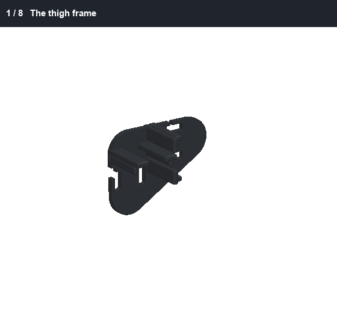

> ⚠ The cable sockets are in notches at the edges of each servo's rear face. Plug the cables in through the windows in the thigh plate, before the cover.

1. The thigh frame
2. Plug in the cables, then drop in both servos
3. 2 screws each, from the outside
4. The lids
5. 4 screws each: 2 far, 2 near the shaft
6. Press in the bearings
7. Horns on, servos at mid-range
8. The cover, 2 screws

Then the same for the right side, mirrored.

## 2. Shins and ankles

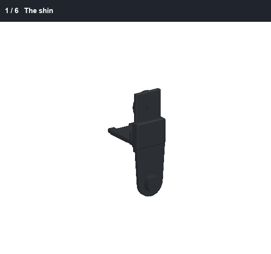

> ⚠ The rear-horn screws go in before the bearing: the bearing covers them.

1. The shin
2. Plug in the cable, slide in the ankle servo
3. Screws: 4 flat-head into the rear horn, 2 at the far end
4. The lid, 2 screws
5. Press the small bearing onto the stub
6. Horn on, servo at mid-range

Then the same for the right side, mirrored.

## 3. Shoes

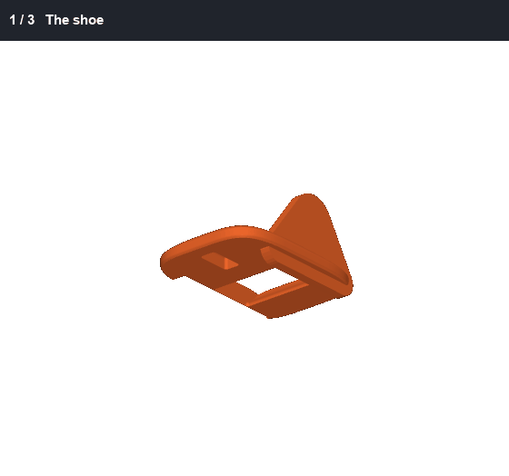

> ⚠ Solder the switch wires before pressing the switch in, and try the switch against the sole before printing all four parts: its travel in this TPU is untested.

1. The shoe
2. Press in the foot switch, its wires soldered first
3. The TPU sole, 2 screws from below

Then the same for the right side, mirrored.

## 4. Join each leg

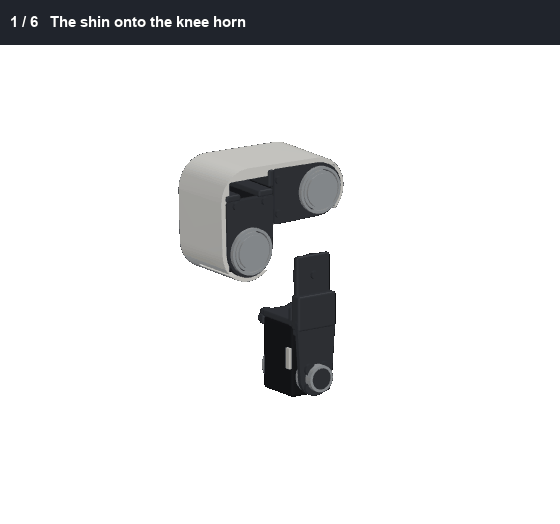

> ⚠ The roll bracket goes onto the hip horn here, on the bench: once the leg is on the robot, the roll servo blocks those 4 screws.

1. The shin onto the knee horn
2. 4 screws from the inside
3. Lift the shoe onto the ankle servo
4. 4 screws through the outer ear
5. The inner ear onto the stub, 2 screws
6. The roll bracket onto the hip horn, 4 screws

Then the same for the right side, mirrored.

## 5. Chassis and hips

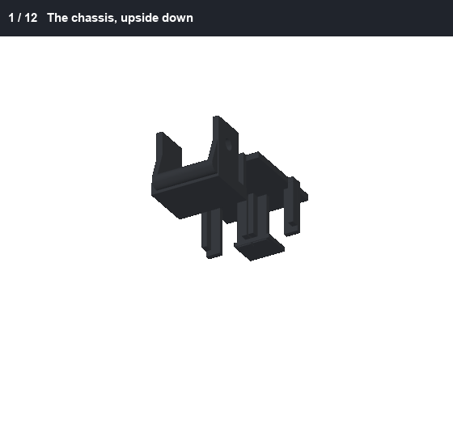

> ⚠ Screw on the yaw brackets **before** the roll servos: the roll servos cover those screws.

1. The chassis, upside down
2. Plug in the cables, push in the hip yaw servos
3. 2 screws each, from the top
4. The lids, 4 screws each
5. Press in the bearings
6. Horns on, servos at mid-range
7. The yaw brackets, 4 screws each, before the roll servos
8. Plug in the cables, slide in the hip roll servos
9. 2 screws each, from behind
10. The lids, 4 screws each
11. Press in the bearings
12. Horns on, servos at mid-range

## 6. Legs onto the hips

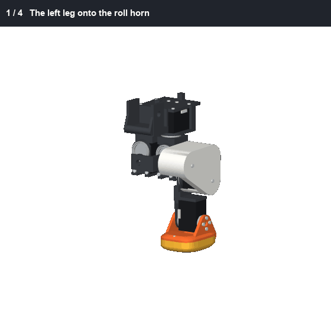

1. The left leg onto the roll horn
2. 4 screws from the front
3. The right leg
4. 4 screws from the front

## 7. Neck column

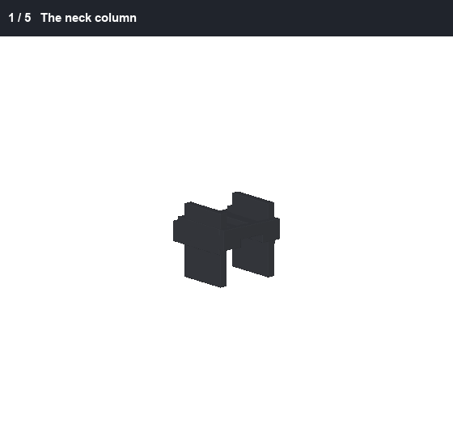

> ⚠ Fit both horns to each servo before it goes in, at mid-range.

1. The neck column
2. Neck servo in, horns on
3. Its lid, 2 screws
4. Head pitch servo in, horns on
5. Its lid, 2 screws

## 8. Neck and body shell

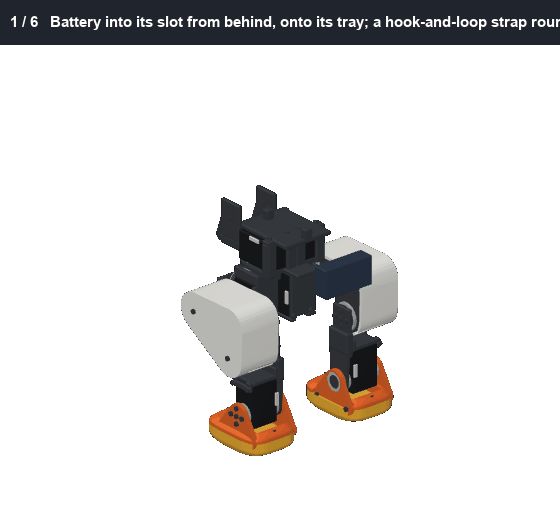

> ⚠ Do the neck before the body shell: the shell blocks the neck's horn screws. Do the shell before the head: the head will not pass through its slot.

1. Battery into its slot from behind, onto its tray; a hook-and-loop strap round both
2. A 5 V regulator into each side pocket
3. The IMU on the top plate, double-sided tape
4. The column down into the chassis fork
5. 4 screws on each horn
6. The body shell, 2 screws

## 9. Head yaw and roll

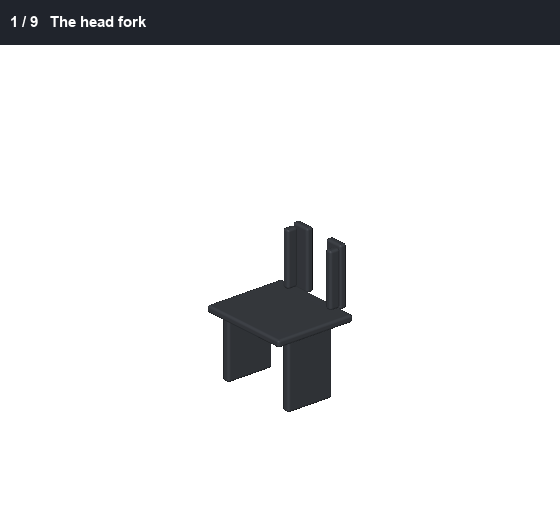

> ⚠ The head yaw servo's screws under the bridge go in here, on the bench: once this is on the neck, they cannot be reached.

1. The head fork
2. Head yaw servo in, 2 screws from under the bridge
3. The thin sheet, 2 screws
4. Bearing and horn
5. The yaw bracket, 4 screws, before its roll servo
6. Head roll servo in from the front
7. The rear bearing and rear horn, from behind
8. The lid, 2 screws
9. Bearing and horn

## 10. The jaw and its rod

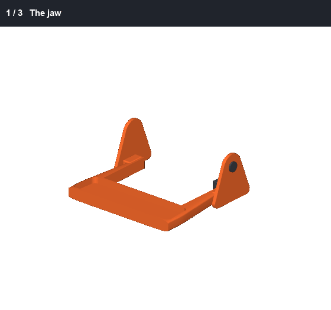

1. The jaw
2. Glue in its soft insert
3. The rod on its lever, 1 screw

## 11. The head

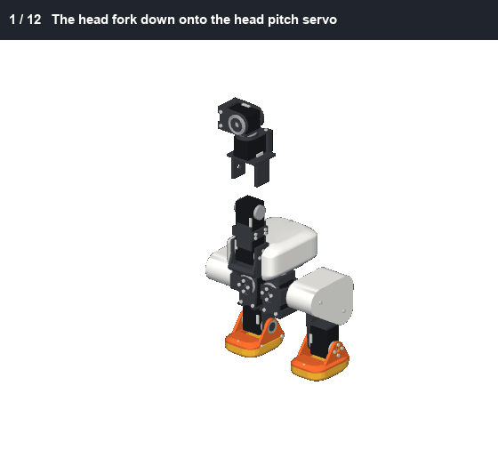

> ⚠ The roll servo's rear horn screws go in before the beak servo, which covers them. The jaw goes in before the hood, for the rod's screw. The hinge screws and the 2 at the back hold the hood on, so they are last.

1. The head fork down onto the head pitch servo
2. 4 screws on each horn
3. The head frame down over the roll servo
4. 4 screws on each horn
5. Beak servo in from the side, 2 screws
6. Its lid, 2 screws
7. The beak crank on its horn, servo at mid-range, 4 screws
8. The U2D2 on the frame, from below, foam tape
9. The Pi onto its plate from the front, 4 screws
10. The jaw, its rod already on its lever, in from the front
11. The rod onto the crank pin
12. The hood, down between the jaw's tabs
13. Let the jaw hang on its rod and glue in the soft mouth roof through the gap
14. The camera, its ribbon to the Pi, then glue in the face (the camera taped to its back), the eye ring and its iris
15. 2 screws up through the band into the hood's back
16. A spacer each side, and the hinge screws hold the jaw and the hood

## Wires

See [WIRING.md](WIRING.md). **Tie the ankle's wires up against its rail:** the shoe's ear passes close by them past 1 rad.
