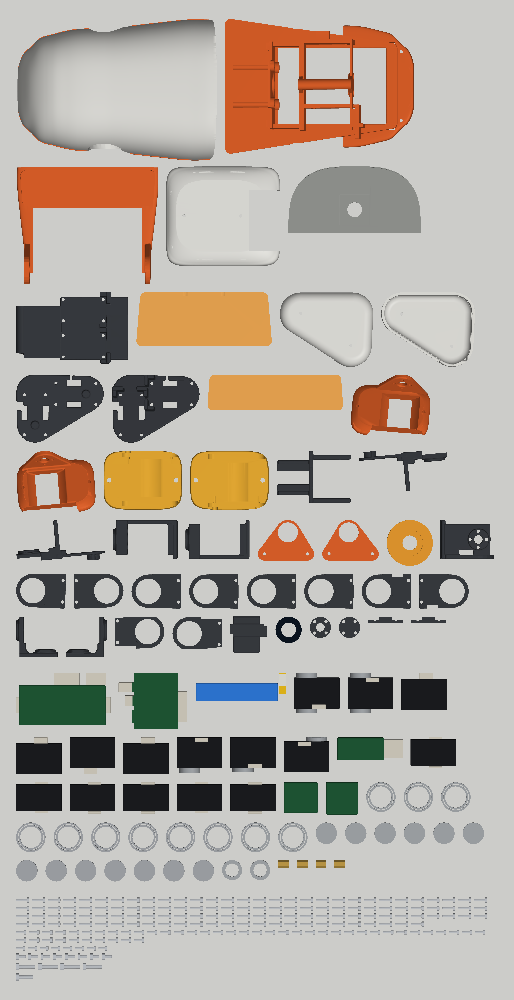

# Wiring the all-Dynamixel duck

Nothing here has been built. Connector positions are from ROBOTIS's own XL330 model.

## Every part

Everything you'll handle, drawn from the model. Its counts are checked against the [BOM](BOM.md). Printed parts are the real Fusion bodies; bought parts are the model's shapes, not the makers' CAD.

The picture is drawn and checked from `spec/wiring_dynamixel.json` by `python -I tools/wiring_diagram.py`: change the config, not the picture.

## Power

| Rail | From | Feeds | Worst case |
|---|---|---|---|
| Battery, 7.4 V nominal, **8.4 V full** | OVONIC 2S 450 mAh 100C, on its XT30 | the board's green terminals, through the neck, then all 15 XL330s through the board. **Past ROBOTIS's 6 V maximum** | All 15 stalling at 5 V would be 22 A (1.47 A each, per ROBOTIS), and more at 7.4 V: expect the pack's voltage to sag first. Walking current hasn't been measured |
| Logic 5 V | hiBCTR USB buck converter in the head, 2 soldered input wires from the green terminals. Its output is 2 wires soldered to its USB socket's 5 V and ground pins, to the Pi's pin 2 (5 V) and pin 6 (ground): no USB cable, as right-angle ones are hard to find. **Measure 5 V at the wires before soldering them to the Pi**: the Pi's pins have no fuse or protection, unlike its PWR port | Pi Zero 2 W, IMU (through the Pi). The bus board's logic comes from its own regulator, off the battery | under 1.5 A |

**Power switch:** Pololu's Big MOSFET Slide Switch, HP (item 2815), on foam tape inside the body's back wall, its slider out through a slot low on the back, right of centre. The battery's red lead goes to its VIN and its VOUT on up the neck; its GND takes a short tap off the black lead, which runs on past it. The XT30 stays plugged, inside the body. It carries about 6 A with the board near 55 C: walking current hasn't been measured, so feel it after a walk.

**Charging:** switch off, then plug the charger into the balance plug, which ends at the port at the back left with the XT30 beneath it. This needs a charger that charges through the balance lead alone: many hobby chargers want the main leads too, and refuse without them.

**PC:** the Pi's micro USB data port is free, as the bus board is on the UART. A rounded hole in the top of the head sits over it, for a plain micro USB cable from the PC. Wi-Fi does the same without a cable.

**One board first.** The user's Mini Duck ran its bigger Feetech servos from one Waveshare board, so start there: socket 1 through the 5 head servos and on from the neck servo to the left leg, socket 2 down the neck to the right leg. That needs no branch in the body, as each servo has only 2 sockets. Each JST EH lead is rated by ROBOTIS's 21 AWG crimp at about 3 A, and socket 1 carries 10 servos. **If the board or leads get warm, or servos reset, unplug and add leg power:** a lead from the battery to each leg's V wire, keeping D and G from socket 2.

## Signals

| From | To | How |
|---|---|---|
| Pi's UART: GPIO 14 (TX, pin 8), GPIO 15 (RX, pin 10), ground (pin 14) | Waveshare Bus Servo Adapter (A), its TX, RX and GND header | 3 wires, about 10 cm, soldered at both ends: the header's pins snipped to 3 mm, the wires laid flat out past the board's edge. Pi TX to board RX, Pi RX to board TX. **Both jumpers at A.** Waveshare's wiki couldn't be read to confirm the header's labels: if no servo answers, swap TX and RX. Before connecting, measure the board's TX against GND with it powered: the Pi's pins take 3.3 V only. The Pi needs its full UART on these pins: `pi/setup_pi.sh` turns Bluetooth and the serial console off, and the code uses `/dev/serial0` at 1 Mbaud |
| Bus board's 2 sockets | the chains | D, V, G. V is only what its DC terminals are given. The sockets may need easing to take Dynamixel plugs: do it before fitting |
| Battery lead, in the neck | bus board's DC+ and DC- terminals, with the regulator's input alongside | feeds everything. **Its silkscreen says DC 9-12.6 V, and the pack is 7.4-8.4 V. Bench test first** |
| Pi I2C (pins 3, 5), 3V3 (pin 1), ground (pin 9) | IMU in the body, a GY-BNO08X board: its VCC, GND, SCL and SDA | 4 thin wires down the neck. Leave its PS0 and PS1 unconnected, for I2C. Its address is 0x4A or 0x4B depending on AD0: `i2cdetect -y 1` shows which, and the Pi code tries both. With the 5 power and UART wires, 9 wires are soldered to the Pi's header, all at its microSD end |
| Pi camera port, at the end of the board by the regulator | camera | 15 cm ribbon. Leave slack: the camera is on the hood, the Pi on the frame |

## The chains

Each servo has 2 sockets, wired through, and the 15 share one bus with IDs 1-15.

- **Left leg:** body -> hip yaw -> hip roll -> hip pitch -> knee -> ankle.
- **Right leg:** the same.
- **Head:** body -> neck -> head pitch -> head yaw -> head roll -> beak.

## Where the wires go

The sockets are in notches at the long edges of each servo's rear face, 4-14 mm from the shaft, their tops 3.1 mm under the face. A plug stays inside the case's outline, and its wires leave sideways, or out the back.

| Servo | Way out |
|---|---|
| Hip pitch, knee | out the back, through 2 windows in the thigh plate, into the 3 mm gap under the cover, to the cover's open inside |
| Hip yaw, hip roll, ankle, neck, head pitch, head yaw | sideways |
| Head roll, beak | sideways; one side through a groove in the plate lying against it |

Across each joint, leave a loop for its whole range. Then move every joint by hand, end to end, before powering up.

## What is not designed

- Wire clips and exact lengths: measure on the build.
- Speaker and microphone.
