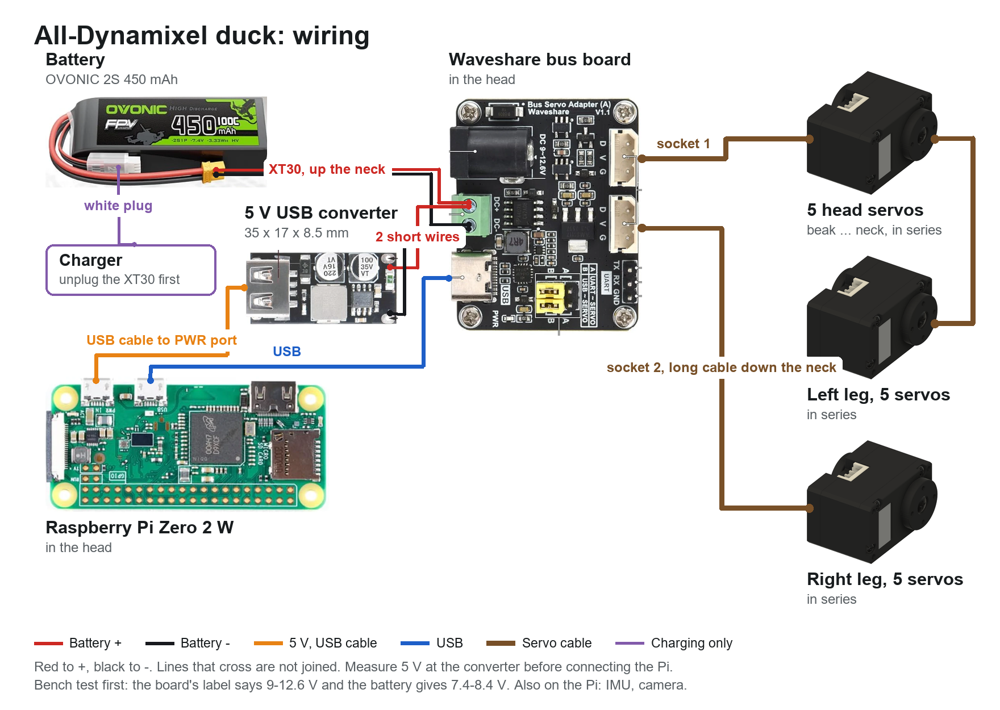

# Wiring the all-Dynamixel duck

Nothing here has been built. Connector positions are from ROBOTIS's own XL330 model.

The picture is drawn and checked from `spec/wiring_dynamixel.json` by `python -I tools/wiring_diagram.py`: change the config, not the picture.

## Power

| Rail | From | Feeds | Worst case |
|---|---|---|---|
| Battery, 7.4 V nominal, **8.4 V full** | OVONIC 2S 450 mAh 100C, on its XT30 | the board's green terminals, through the neck, then all 15 XL330s through the board. **Past ROBOTIS's 6 V maximum** | All 15 stalling at 5 V would be 22 A (1.47 A each, per ROBOTIS), and more at 7.4 V: expect the pack's voltage to sag first. Walking current hasn't been measured |
| Logic 5 V | hiBCTR USB buck converter in the head, 2 soldered input wires from the green terminals, USB cable to the Pi's PWR port: **measure it before connecting anything** | Pi Zero 2 W, IMU (through the Pi). The bus board's logic comes over its USB-C | under 1.5 A |

No power switch is designed in: unplug the XT30, which sits with the balance plug in the port at the rear of the body. To charge, unplug the XT30 first, then use the balance plug.

**One board first.** The user's Mini Duck ran its bigger Feetech servos from one Waveshare board, so start there: socket 1 through the 5 head servos and on from the neck servo to the left leg, socket 2 down the neck to the right leg. That needs no branch in the body, as each servo has only 2 sockets. Each JST EH lead is rated by ROBOTIS's 21 AWG crimp at about 3 A, and socket 1 carries 10 servos. **If the board or leads get warm, or servos reset, unplug and add leg power:** a lead from the battery to each leg's V wire, keeping D and G from socket 2.

## Signals

| From | To | How |
|---|---|---|
| Pi micro USB (the port marked USB), right-angle OTG lead | Waveshare Bus Servo Adapter (A), USB-C | both jumpers at B. Right-angle at both ends: there is 12 mm beside the board. The Pi's USB edge faces up, under the hood, with about 15 mm above it. The OTG plug's cable must leave toward the microSD end, and the PWR plug's toward the camera end, or they meet |
| Bus board's 2 sockets | the chains | D, V, G. V is only what its DC terminals are given. The sockets may need easing to take Dynamixel plugs: do it before fitting |
| Battery lead, in the neck | bus board's DC+ and DC- terminals, with the regulator's input alongside | feeds everything. **Its silkscreen says DC 9-12.6 V, and the pack is 7.4-8.4 V. Bench test first** |
| Pi I2C (pins 3, 5), 3V3, ground | IMU in the body | 4 thin wires down the neck |
| Pi camera port, at the end of the board by the regulator | camera | 15 cm ribbon. Leave slack: the camera is on the hood, the Pi on the frame |

## The chains

Each servo has 2 sockets, wired through, and the 15 share one bus with IDs 1-15.

- **Left leg:** body -> hip yaw -> hip roll -> hip pitch -> knee -> ankle.
- **Right leg:** the same.
- **Head:** body -> neck -> head pitch -> head yaw -> head roll -> beak.

## Where the wires go

The sockets are in notches at the long edges of each servo's rear face, 4-14 mm from the shaft, their tops 3.1 mm under the face. A plug stays inside the case's outline, and its wires leave sideways, or out the back.

| Servo | Way out |
|---|---|
| Hip pitch, knee | out the back, through 2 windows in the thigh plate, into the 3 mm gap under the cover, to the cover's open inside |
| Hip yaw, hip roll, ankle, neck, head pitch, head yaw | sideways |
| Head roll, beak | sideways; one side through a groove in the plate lying against it |

Across each joint, leave a loop for its whole range. Then move every joint by hand, end to end, before powering up.

## What is not designed

- A power switch: the XT30 does it.
- Wire clips and exact lengths: measure on the build.
- Speaker and microphone.
