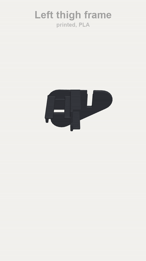
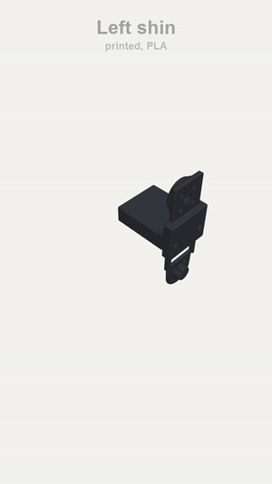
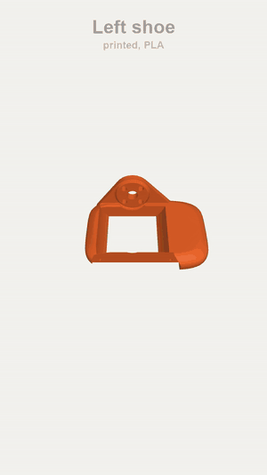
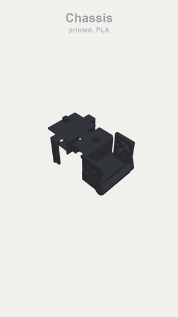
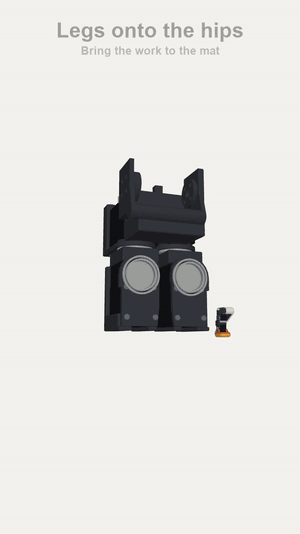
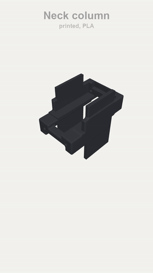
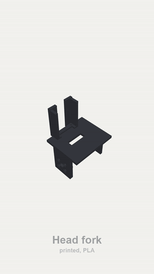
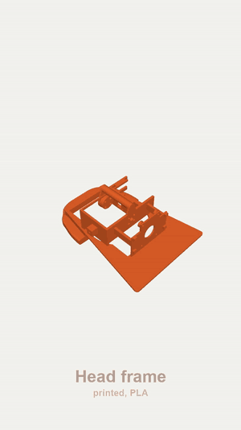
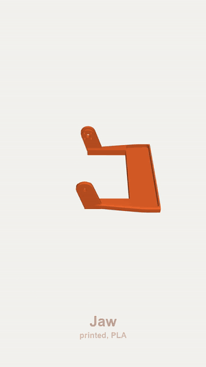

# How to build the all-Feetech duck

Generated by `tools/make_docs.py` from the order in `tools/assembly.py`. That order is checked: every part can
slide in along the path shown without hitting what is already on, and a key reaches every screw (`python -I tools/assembly.py`).

Watch each animation, then do the same.  Parts: [BOM.md](BOM.md). The right side is the mirror of the left, so only the left is shown.

> ⚠ marks what has to happen in that order, or cannot be done later.

## 0. Before you start

1. **Print one joint first** ([prints/feetech/README.md](../../prints/feetech/README.md)), then everything. None of it has been test printed yet.
2. **Set each servo's ID on its own**, before any are chained: Feetech 1-15, one at a time on the Waveshare board. Label each servo.
3. **Move each servo to mid-range** and keep it there: horns go on at mid-range, or the joint's range will be off-centre.
4. **The pockets are cut 0.3 mm over the servos and 0.1 mm over the bearings.** If yours print tight or loose, change that once in tools/export_prints.py.

Tools: a small Phillips driver, 2 and 2.5 mm hex keys, soldering iron (a grown-up, if you are young), threadlock for screws into metal. Self-tapping screws into plastic: stop when snug, as they strip.

## 1. Thighs

[Sharper, with controls (MP4)](../images/assembly/feetech/clips/thigh_L.mp4)

> ⚠ The cable sockets are on each servo's rear face, behind a window in the plate. Plug the cables in from outside, before the cover, with room to turn the wires under it.

> 🔌 Each thigh servo has 2 sockets, wired through. A lead from the knee to the hip pitch, and one out of the hip pitch toward the roll servo. Plug them in now: the plate covers the sockets.

**Screws for this section:** 10 x M2 x 6 mm, 4 x M2 x 8 mm (each side)

1. The thigh frame
2. Plug in the cables, then drop in both servos
3. The screws from the outside *(4 x M2 x 8 mm, small Phillips)*
4. The lids
5. The lid screws *(8 x M2 x 6 mm, small Phillips)*
6. Press in the bearings
7. Horns on, servos at mid-range
8. The cover, 2 screws *(2 x M2 x 6 mm, small Phillips)*

Then the same for the right side, mirrored.

## 2. Shins and ankles

[Sharper, with controls (MP4)](../images/assembly/feetech/clips/shin_L.mp4)

> ⚠ The rear-horn screws go in before the bearing: the bearing covers them.

> 🔌 The ankle is the end of its leg's chain: one lead up to the knee. Leave slack across the knee and tie it to the rail.

**Screws for this section:** 2 x M2 x 8 mm, 4 x M3 flat x 6 mm (each side)

1. The shin
2. Plug in the cable, slide in the ankle servo
3. Screws: 4 flat-head into the rear horn, 2 at the far end *(2 x M2 x 8 mm, small Phillips; 4 x M3 flat x 6 mm, 2 mm hex)*
4. Press the small bearing onto the stub
5. Horn on, servo at mid-range

Then the same for the right side, mirrored.

## 3. Shoes

[Sharper, with controls (MP4)](../images/assembly/feetech/clips/shoe_L.mp4)

**Screws for this section:** 2 x M3 x 12 mm (each side)

1. The shoe
2. The TPU sole, 2 screws from below *(2 x M3 x 12 mm, 2.5 mm hex)*

Then the same for the right side, mirrored.

## 4. Join each leg

[Sharper, with controls (MP4)](../images/assembly/feetech/clips/leg_L.mp4)

> ⚠ The roll bracket goes onto the hip horn here, on the bench: once the leg is on the robot, the roll servo blocks those 4 screws.

**Screws for this section:** 2 x M2 x 8 mm, 4 x M3 x 8 mm, 8 x M3 x 10 mm (each side)

1. The shin onto the knee horn
2. 4 screws from the inside *(4 x M3 x 10 mm, 2.5 mm hex)*
3. Lift the shoe onto the ankle servo
4. 4 screws through the outer ear *(4 x M3 x 8 mm, 2.5 mm hex)*
5. The inner ear onto the stub, 2 screws *(2 x M2 x 8 mm, small Phillips)*
6. The roll bracket onto the hip horn, 4 screws *(4 x M3 x 10 mm, 2.5 mm hex)*

Then the same for the right side, mirrored.

## 5. Chassis and hips

[Sharper, with controls (MP4)](../images/assembly/feetech/clips/body.mp4)

> ⚠ Screw on the yaw brackets **before** the roll servos: the roll servos cover those screws.

> 🔌 One lead from each hip yaw servo to the body, and one on to its roll servo, before each servo goes in.

**Screws for this section:** 16 x M2 x 6 mm, 8 x M2 x 8 mm, 8 x M3 x 10 mm

1. The chassis, upside down
2. Plug in the cables, push in the hip yaw servos
3. 2 screws each, from the top *(4 x M2 x 8 mm, small Phillips)*
4. The lids and their screws *(8 x M2 x 6 mm, small Phillips)*
5. Press in the bearings
6. Horns on, servos at mid-range
7. The yaw brackets, 4 screws each, before the roll servos *(8 x M3 x 10 mm, 2.5 mm hex)*
8. Plug in the cables, slide in the hip roll servos
9. 2 screws each, from behind *(4 x M2 x 8 mm, small Phillips)*
10. The lids and their screws *(8 x M2 x 6 mm, small Phillips)*
11. Press in the bearings
12. Horns on, servos at mid-range

## 6. Legs onto the hips

[Sharper, with controls (MP4)](../images/assembly/feetech/clips/legs.mp4)

> 🔌 Plug the leg's lead into the roll servo as it comes on, with slack for the hip's whole range.

**Screws for this section:** 8 x M3 x 10 mm

1. The left leg onto the roll horn
2. 4 screws from the front *(4 x M3 x 10 mm, 2.5 mm hex)*
3. The right leg
4. 4 screws from the front *(4 x M3 x 10 mm, 2.5 mm hex)*

## 7. Neck column

[Sharper, with controls (MP4)](../images/assembly/feetech/clips/column.mp4)

> ⚠ Fit both horns to each servo before it goes in, at mid-range.

> 🔌 A lead between the two neck servos, plugged into their rear faces before each goes in. The neck's second socket stays empty: the legs are fed from the hub.

**Screws for this section:** 4 x M2 x 6 mm, 4 x M2 x 8 mm

1. The neck column
2. Neck servo in, horns on *(2 x M2 x 8 mm, small Phillips)*
3. Its lid, 2 screws *(2 x M2 x 6 mm, small Phillips)*
4. Head pitch servo in, horns on *(2 x M2 x 8 mm, small Phillips)*
5. Its lid, 2 screws *(2 x M2 x 6 mm, small Phillips)*

## 8. Neck and body shell

[Sharper, with controls (MP4)](../images/assembly/feetech/clips/torso.mp4)

> ⚠ Do the neck before the body shell: the shell blocks the neck's horn screws. Do the shell before the head: the head will not pass through its slot.

> 🔌 Solder the leg hub first (WIRING.md): the XT30's wires, the battery pair up the neck, a lead to each hip yaw servo, and socket 2's lead with its V wire cut. Tape it beside the battery, and run the 3 bundles up through the slot before the shell goes on.

**Screws for this section:** 2 x M2 x 6 mm, 4 x M3 x 8 mm, 4 x M3 x 12 mm

1. Battery into its slot from behind, onto its tray; a hook-and-loop strap round both
2. The IMU on the top plate, double-sided tape
3. The column down into the chassis fork
4. 4 screws on each horn *(4 x M3 x 8 mm, 2.5 mm hex; 4 x M3 x 12 mm, 2.5 mm hex)*
5. The body shell, 2 screws *(2 x M2 x 6 mm, small Phillips)*

## 9. Head yaw and roll

[Sharper, with controls (MP4)](../images/assembly/feetech/clips/headbench.mp4)

> ⚠ The head yaw servo's screws under the bridge go in here, on the bench: once this is on the neck, they cannot be reached.

> 🔌 A lead from the yaw servo, through the window in the bridge, on to the neck chain, and one to the roll servo, with slack for the yaw's range of +/- 2.5 rad: it winds round.

**Screws for this section:** 8 x M2 x 6 mm, 4 x M2 x 8 mm, 4 x M3 x 10 mm

1. The head fork
2. Head yaw servo in, 2 screws from under the bridge *(2 x M2 x 8 mm, small Phillips)*
3. The thin sheet, 2 screws *(4 x M2 x 6 mm, small Phillips)*
4. Bearing and horn
5. The yaw bracket, 4 screws, before its roll servo *(4 x M3 x 10 mm, 2.5 mm hex)*
6. Head roll servo in from the front *(2 x M2 x 8 mm, small Phillips)*
7. The rear bearing and rear horn, from behind
8. The lid, 2 screws *(4 x M2 x 6 mm, small Phillips)*
9. Bearing, horn and spacer

## 9b. The head frame and the beak servo

[Sharper, with controls (MP4)](../images/assembly/feetech/clips/framebench.mp4)

> 🔌 The beak servo ends the head's chain: one lead, in its upper socket, plugged in before it goes in. Turn its wires back toward the rear at once: there is no room to leave them straight.

**Screws for this section:** 4 x M2 x 8 mm, 4 x M2.5 x 5 mm

1. The head frame
2. The bus board's brass standoffs into their hex sockets, a screw from the front into each *(4 x M2.5 x 5 mm, small Phillips)*
3. Beak servo in from the side, its horn out, servo at mid-range, 4 screws from inside (the roll servo blocks them later) *(4 x M2 x 8 mm, small Phillips)*

## 10. The jaw

[Sharper, with controls (MP4)](../images/assembly/feetech/clips/jawbench.mp4)

1. The jaw
2. Glue in its soft insert

## 11. The head

[Sharper, with controls (MP4)](../images/assembly/feetech/clips/head.mp4)

> ⚠ The beak servo goes into the head frame first, on the bench: the roll servo blocks its screws afterwards. The jaw goes in before the hood. The far hinge screw and the 2 at the back hold the hood on, so they are last.

> 🔌 Socket 1 feeds the head chain, socket 2 the long lead down the neck. The battery pair goes to the green terminals. Plug in these and the right-angle USB-C lead before the board goes on.

**Screws for this section:** 4 x M2 x 6 mm, 2 x M2 x 8 mm, 4 x M2.5 x 5 mm, 8 x M3 x 8 mm, 5 x M3 x 10 mm, 8 x M3 x 12 mm

1. The head fork down onto the head pitch servo
2. 4 screws on each horn *(4 x M3 x 8 mm, 2.5 mm hex; 4 x M3 x 12 mm, 2.5 mm hex)*
3. The head frame, with its beak servo, down over the roll servo
4. 4 screws on each horn *(4 x M3 x 10 mm, 2.5 mm hex; 4 x M3 x 12 mm, 2.5 mm hex)*
5. The bus board down onto them, 4 screws. Its leads on first: servo sockets, power terminals, USB-C *(4 x M2.5 x 5 mm, small Phillips)*
6. The Pi onto its plate from the front, its USB ports up and its microSD card in, 4 screws. Then its 2 right-angle plugs, and the camera ribbon out of its socket *(4 x M2 x 6 mm, small Phillips)*
7. The 5 V USB converter on edge on the base beside the Pi, foam tape: its input to the green terminals, a USB cable to the PWR port of the Pi
8. The jaw, up from below, its tab sliding onto the horn, 4 screws *(4 x M3 x 8 mm, 2.5 mm hex)*
9. The hood, down between the jaw's tabs
10. Open the jaw and glue in the soft mouth roof through the gap
11. The camera, its ribbon to the Pi, then glue in the face (the camera taped to its back), the eye ring and its iris
12. 2 screws up through the band into the hood's back *(2 x M2 x 8 mm, small Phillips)*
13. A 0.5 mm washer, and the hinge screw on the far side holds the jaw and the hood *(1 x M3 x 10 mm, 2.5 mm hex)*

## 12. Try every joint

Move each joint by hand, slowly, through its range, with the power off. Nothing should catch or bind.

## Wires

See [WIRING.md](WIRING.md). **Tie the ankle's wires up against its rail:** the shoe's ear passes close by them past 1 rad.
