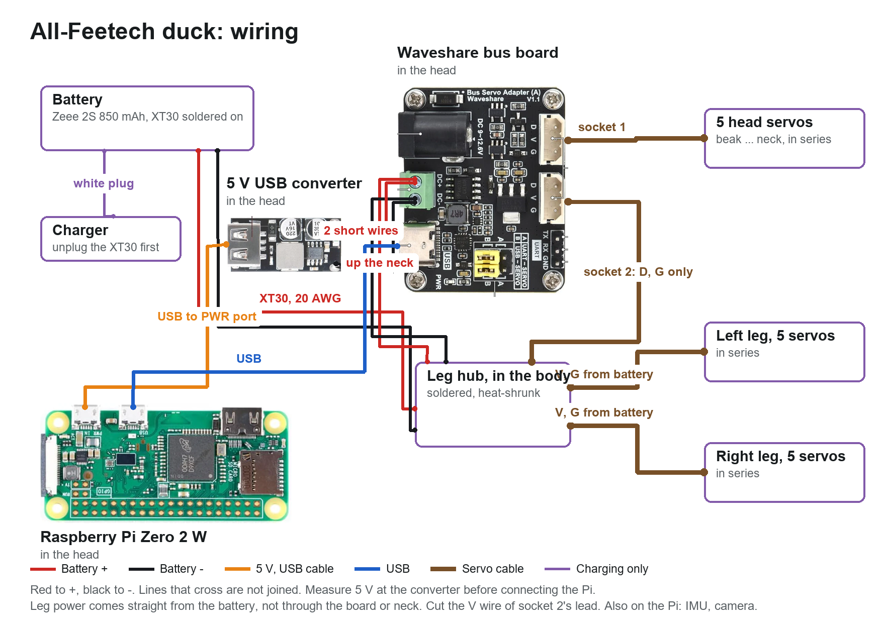

# Wiring the all-Feetech duck

Nothing here has been built. Socket positions are from the STS3215 STEP file in SO-ARM100. Currents and voltages are sellers' figures, not measured.

The picture is drawn and checked from `spec/wiring_feetech.json`:

    python -I tools/wiring_diagram.py spec/wiring_feetech.json docs/dynamixel/parts docs/feetech/wiring.png

Change the config, not the picture.

## Why it differs from the all-Dynamixel duck

Both use one Waveshare board in the head. The all-Dynamixel duck feeds all 15 servos through that board and up the neck. These servos draw too much for that, so **the legs take their power straight from the battery**, in the body. Only data and ground come down from the board.

| Servo | Rated, each | Stall, each | All 10 in the legs stalling | All 15 stalling |
|---|---|---|---|---|
| STS3215-C044, 7.4 V | 1.2 A | 3.8 A ([OpenELAB's listing](https://openelab.io/products/feetech-sts3215-c044-servo-7)) | 38 A | 57 A |

Waveshare publishes no current rating for the board. Its 5264 plugs are commonly listed at about 3 A a pin: that figure is from memory of the connector family, so check it. One plug can't carry a walking duck's legs.

## Power

| Rail | From | Feeds | Worst case |
|---|---|---|---|
| Battery, 7.4 V nominal, **8.4 V full** | Zeee 2S 850 mAh 50C, with an XT30 soldered on (it comes on a small JST) | the leg hub in the body | 57 A if everything stalls. The pack's label allows 42 A and an XT30 is usually rated 30 A continuous. A real stall of all 15 shouldn't happen, and walking current hasn't been measured |
| Leg hub to each leg | 2 leads, V and G from the XT30's wires, D from the board | 5 servos each | 19 A if a whole leg stalls, past the plug's rating: keep stalls short in software |
| Battery pair up the neck, 20 AWG | the hub | the board's green terminals, then the 5 head servos through socket 1, and the converter | an estimate of 1.4 A held still in the worst pose checked (their torque as a share of rated, 115 % in all, if current follows torque), plus the Pi; 19 A if all 5 stall |
| Logic 5 V | hiBCTR USB buck converter in the head, 2 soldered input wires from the green terminals, USB cable to the Pi's PWR port: **measure it before connecting anything** | Pi Zero 2 W, IMU (through the Pi). The board's logic comes over its USB-C | under 1.5 A |

No power switch is designed in: unplug the XT30, which sits with the balance plug in the port at the rear of the body, on its left. To charge, unplug the XT30 first, then use the balance plug.

**Voltage.** The board's silkscreen says 9-12.6 V, but [Waveshare's page](https://docs.waveshare.com/Bus_Servo_Adapter_A) says 5-8.4 V can also be input, and that it must match the servos. [Tinytronics](https://www.tinytronics.nl/en/mechanics-and-actuators/motor-controllers-and-drivers/servomotor-controllers/waveshare-serial-bus-servo-adapter-(a)) lists a 7 V minimum, so stop at 7.0 V under load. OpenELAB lists the C044's input as 5-8.4 V, while other sellers rate the 7.4 V STS3215 to 7.4 V: a full pack may be over what some allow. Bench test one servo and the board first.

## The leg hub

The hub isn't a bought part. It's 3 soldered joints under heat-shrink, taped in the body beside the battery:

- **V:** XT30 red, the red wire up the neck, and the V wire of each leg's lead.
- **G:** XT30 black, the black wire up the neck, the G of each leg's lead, and the G of socket 2's lead. All grounds must join, or the data has no return.
- **D:** the D of socket 2's lead and the D of each leg's lead.

**Cut and insulate the V wire of socket 2's lead,** at both ends. Left joined, it ties the leg supply to the board's sockets through a thin wire.

Use 5264 3-pin leads, cut in half, for the 2 leg ends.

## Signals

| From | To | How |
|---|---|---|
| Pi micro USB (the port marked USB), right-angle OTG lead | Waveshare Bus Servo Adapter (A), USB-C | both jumpers at B. The Pi's USB edge faces up, under the hood. The OTG plug's cable must leave toward the microSD end, and the PWR plug's toward the camera end, or they meet |
| Board's socket 1 | beak, then roll, yaw, head pitch, neck | 5264 3-pin. The board's header is listed as Molex 5264 compatible, as are the servos' sockets, so no adapter |
| Board's socket 2 | the leg hub, down the neck | D and G only |
| Pi I2C (pins 3, 5), 3V3, ground | IMU in the body | 4 thin wires down the neck |
| Pi camera port | camera | 15 cm ribbon, with slack: the camera is on the hood, the Pi on the frame |

## The chains

Each servo has 2 sockets, wired through, and the 15 share one bus with IDs 1-15.

- **Head:** board socket 1 -> beak -> head roll -> head yaw -> head pitch -> neck. The neck's second socket stays empty.
- **Left leg:** hub -> hip yaw -> hip roll -> hip pitch -> knee -> ankle.
- **Right leg:** the same.

## Crossing the neck

3 bundles go through the neck joints and the head's +/- 2.5 rad of yaw: the battery pair, socket 2's lead, and 4 IMU wires. Leave a loop for each joint's whole range, tie them to the column, and move every joint by hand, end to end, before powering up.

## In the head

The Pi and the board stand in front of the head frame's plate, and the servos behind it. That plate runs nearly the width of the head, so everything that crosses it goes **over its top**, with about 20 mm under the hood, or round its ends. The bundles from the neck come up through the opening in the head's base, beside the yaw bracket. The board's servo sockets are on the side away from the regulator and its power terminals on the other, so the regulator's 2 input wires pass the board's edge: in the model, nothing but its plugs is there. The wires aren't modelled, so route them on the bench and check the head's whole range of roll.

## Where the wires go

The sockets are on each servo's rear face, 11.4-16.5 mm from the shaft, side by side. A plug stands 7 mm off that face, and its wires need 3 mm more to turn.

| Servo | Way out |
|---|---|
| Hip yaw | up through a window in the top plate |
| Hip roll | back through a window in its rear plate |
| Hip pitch, knee | through windows in the thigh plate, into the gap under the cover, to its open inside |
| Ankle | through the stub plate, then straight up, tied to the rail: the shoe's ear passes close past 1 rad |
| Neck, head pitch | out of the rear face, under the plate on the rear horn, which stands 3 mm further off for this |
| Head yaw | down through a window in the head fork's bridge, then out sideways over the head pitch servo |
| Head roll | out of the rear face, under the rear plate. No rear bearing here: its race would sit on the plugs |
| Beak | one plug, upper socket, through a window in the rail. **Its wires must turn at once,** back along the gap beside the roll servo: 7.5 mm is modelled, not 10 |

These are the plugs and windows. The checks prove the plugs clear every joint's range, but not the wires themselves: no wire is modelled past its plug.

## What is not designed

- A power switch: the XT30 does it.
- A fuse: consider one at the XT30, once walking current is measured.
- Wire clips and exact lengths: measure on the build.
- Speaker and microphone.
