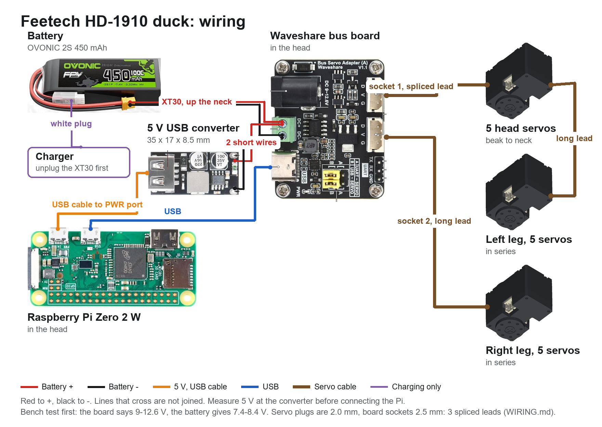

# Wiring the Feetech HD-1910 duck

Nothing here has been built. Connector positions are from Feetech's own HD-1910-C001 model, and its pins and current from Feetech's spec sheet (A/0, 2026-09-07).

The picture is drawn and checked from `spec/wiring_hd1910.json` by `python -I tools/wiring_diagram.py spec/wiring_hd1910.json docs/hd1910/parts docs/hd1910/wiring.png`: change the config, not the picture.

## Power

| Rail | From | Feeds | Worst case |
|---|---|---|---|
| Battery, 7.4 V nominal, **8.4 V full** | OVONIC 2S 450 mAh 100C, on its XT30 | the board's green terminals, through the neck, then all 15 HD-1910s through the board. Inside Feetech's 4-8.4 V | All 15 stalling at 7.4 V would be 30 A (2 A each, per Feetech); 0.9 A each at rated load is 13.5 A. Expect the pack's voltage to sag first. Walking current hasn't been measured |
| Logic 5 V | hiBCTR USB buck converter in the head, 2 soldered input wires from the green terminals, USB cable to the Pi's PWR port: **measure it before connecting anything** | Pi Zero 2 W, IMU (through the Pi). The bus board's logic comes over its USB-C | under 1.5 A |

No power switch is designed in: unplug the XT30, which sits with the balance plug in the port at the rear of the body. To charge, unplug the XT30 first, then use the balance plug.

**One board.** These are the kind of servo the Waveshare board is sold for, so there is no second bus: socket 1 through the 5 head servos and on from the neck servo to the left leg, socket 2 down the neck to the right leg. That needs no branch in the body, as each servo has only 2 sockets. A thin lead and its 2.0 mm plug are the weak point: their current rating isn't published, and socket 1 carries 10 servos. **If the board or leads get warm, or servos reset, unplug and add leg power:** a lead from the battery to each leg's Vcc wire, keeping signal and ground from socket 2.

## The servo's plug doesn't fit the board

| | Plug or socket | Pitch | Source |
|---|---|---|---|
| HD-1910's 2 sockets, and its 15 cm lead | AMP2.0-3P | 2.0 mm | Feetech's sheet; 2.0 mm between pins in its STEP file |
| Waveshare board's 2 sockets | D, V, G; as an STS3215 lead's 5264 plug | 2.5 mm | measured from Waveshare's dimensioned photo; **measure on the board** |

So no lead from a servo box plugs into the board. **Make 3 special leads** from 2 of the 15 servo leads, which leaves 1 spare. Cut each of the 2 leads in half, for 4 ends with an AMP2.0 plug.

| Lead | One end | The other | Length |
|---|---|---|---|
| Board socket 1 to beak servo | board plug | half a servo lead | as short as reaches, about 15 cm |
| Board socket 2 to right hip yaw | board plug | half a servo lead, with bus wire between | 300-400 mm |
| Neck servo to left hip yaw | half a servo lead | half a servo lead, with bus wire between | 300-400 mm |

**All 3 wires in a servo lead are black.** The sheet gives pin 1 signal, pin 2 Vcc, pin 3 ground. The board's order is D, V, G, the same order. So mark one wire before cutting, splice straight through, and test the finished lead end to end with a meter. A crossed Vcc on the signal pin would be a costly mistake on a 2S pack. Heat-shrink each joint on its own.

## Signals

| From | To | How |
|---|---|---|
| Pi micro USB (the port marked USB), right-angle OTG lead | Waveshare Bus Servo Adapter (A), USB-C | both jumpers at B. Right-angle at both ends: there is 12 mm beside the board. The Pi's USB edge faces up, under the hood, with about 15 mm above it. The OTG plug's cable must leave toward the microSD end, and the PWR plug's toward the camera end, or they meet |
| Bus board's 2 sockets | the chains | D, V, G. V is only what its DC terminals are given |
| Battery lead, in the neck | bus board's DC+ and DC- terminals, with the regulator's input alongside | feeds everything. **Its silkscreen says DC 9-12.6 V, and the pack is 7.4-8.4 V. Bench test first** |
| Pi I2C (pins 3, 5), 3V3, ground | IMU in the body | 4 thin wires down the neck |
| Pi camera port, at the end of the board by the regulator | camera | 15 cm ribbon. Leave slack: the camera is on the hood, the Pi on the frame |

## Setting up the servos

Every HD-1910 leaves the factory as ID 1, at 1 Mbps, in position PD mode. Connect them one at a time and give each its own ID, 1-15, before chaining any. From the factory, over-temperature protection is on at 80 C and over-current protection is off. Its setting, if turned on, is 0.5 A for 2 s, which walking would trip. Feetech's pages don't say which of its protocols this servo speaks, so try SMS/STS first on one servo.

## The chains

Each servo has 2 sockets, wired through, and the 15 share one bus with IDs 1-15.

- **Left leg:** body -> hip yaw -> hip roll -> hip pitch -> knee -> ankle.
- **Right leg:** the same.
- **Head:** body -> neck -> head pitch -> head yaw -> head roll -> beak.

## Where the wires go

The sockets are in notches at the long edges of each servo's rear face, 4.6-12.5 mm from the shaft, their tops 2.5 mm under the face, with the notch open at the side. A plug's wires leave sideways, or out the back.

| Servo | Way out |
|---|---|
| Hip pitch, knee | out the back, through 2 windows in the thigh plate, into the 3 mm gap under the cover, to the cover's open inside |
| Hip yaw, hip roll, ankle, neck, head pitch, head yaw | sideways |
| Head roll, beak | sideways; one side through a groove in the plate lying against it |

Across each joint, leave a loop for its whole range. Then move every joint by hand, end to end, before powering up. A 15 cm lead is 3 cm shorter than a Dynamixel's: check the head yaw's and hip links for slack first, as those turn furthest.

## What is not designed

- A power switch: the XT30 does it.
- Wire clips and exact lengths: measure on the build.
- Speaker and microphone.
