# How to build the hobby-servo duck

Generated by `tools/make_docs.py` from the order in `tools/assembly.py`. That order is checked: every part can
slide in along the path shown without hitting what is already on, and a key reaches every screw (`python -I tools/assembly.py`).

Watch each animation, then do the same.  Parts: [BOM.md](BOM.md). The right side is the mirror of the left, so only the left is shown.

> ⚠ marks what has to happen in that order, or cannot be done later.

## 0. Before you start

1. **Print one joint first** ([prints/hobby/README.md](../../prints/hobby/README.md)), then everything. None of it has been test printed yet.
2. **No IDs: each servo has its own channel** on the PWM bonnet (the table in [WIRING.md](WIRING.md)). Label each servo with its channel, and plug it in alone to check it moves.
3. **Move each servo to mid-range** and keep it there: horns go on at mid-range, or the joint's range will be off-centre. A one-way PWM servo can't say where it is: send it 1500 us and fit the horn there, the nearest spline tooth.
4. **The pockets are cut 0.3 mm over the servos and 0.1 mm over the bearings.** If yours print tight or loose, change that once in tools/export_prints.py.

Tools: a small Phillips driver, 2 and 2.5 mm hex keys, soldering iron (a grown-up, if you are young), threadlock for screws into metal. Self-tapping screws into plastic: stop when snug, as they strip.

## 1. Thighs

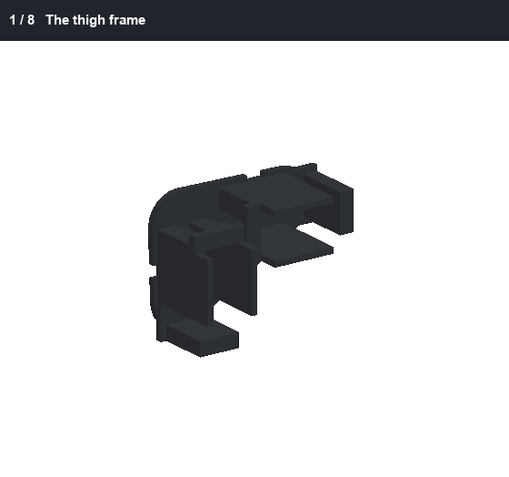

> ⚠ The cable sockets are in notches at the edges of each servo's rear face. Plug the cables in through the windows in the thigh plate, before the cover.

> 🔌 Each servo keeps its own lead, out through the window low in its tray's far end wall, to the PWM bonnet in the body. Leave a 30 mm loop at every joint it crosses, tied each side ([WIRING.md](WIRING.md)).

**Screws for this section:** 2 x M2 x 6 mm, 4 x M3 x 6 mm, 4 x M3 x 16 mm (each side)

1. The thigh frame
2. Plug in the cables, then drop in both servos
3. The screws from the outside *(4 x M3 x 6 mm, 2.5 mm hex)*
4. The lids
5. The lid screws *(4 x M3 x 16 mm, 2.5 mm hex)*
6. Press in the bearings
7. Horns on, servos at mid-range
8. The cover, 2 screws *(2 x M2 x 6 mm, small Phillips)*

Then the same for the right side, mirrored.

## 2. Shins and ankles

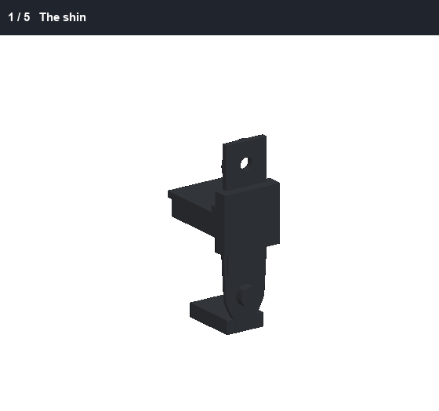

> 🔌 Each servo keeps its own lead, out through the window low in its tray's far end wall, to the PWM bonnet in the body. Leave a 30 mm loop at every joint it crosses, tied each side ([WIRING.md](WIRING.md)).

**Screws for this section:** 4 x M3 x 6 mm (each side)

1. The shin
2. Plug in the cable, slide in the ankle servo
3. Screws: 2 through the far ears, 2 through the near ears *(4 x M3 x 6 mm, 2.5 mm hex)*
4. Press the small bearing onto the stub
5. Horn on, servo at mid-range

Then the same for the right side, mirrored.

## 3. Shoes

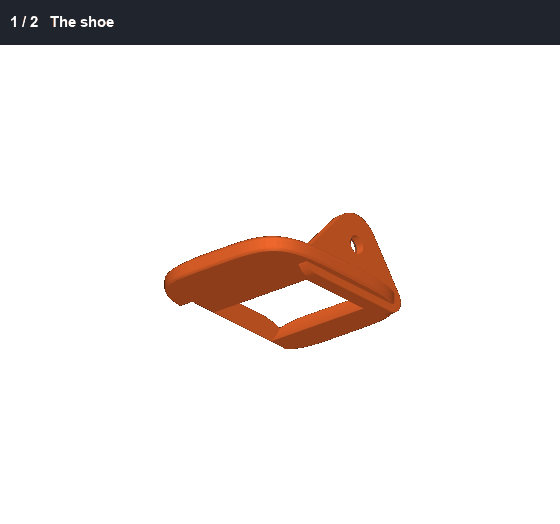

**Screws for this section:** 2 x M3 x 12 mm (each side)

1. The shoe
2. The TPU sole, 2 screws from below *(2 x M3 x 12 mm, 2.5 mm hex)*

Then the same for the right side, mirrored.

## 4. Join each leg

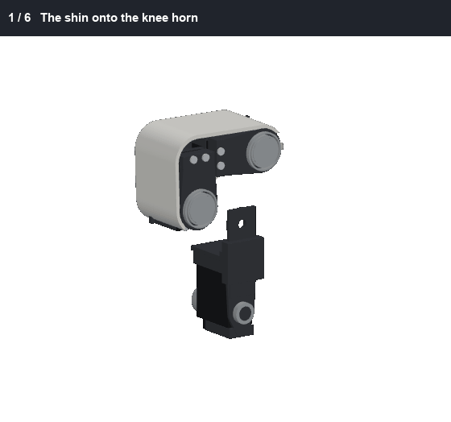

**Screws for this section:** 2 x M2 x 8 mm, 12 x M3 x 6 mm (each side)

1. The shin onto the knee horn
2. 4 screws from the inside *(4 x M3 x 6 mm, 2.5 mm hex)*
3. Lift the shoe onto the ankle servo
4. 4 screws through the outer ear *(4 x M3 x 6 mm, 2.5 mm hex)*
5. The inner ear onto the stub, 2 screws *(2 x M2 x 8 mm, small Phillips)*
6. The roll bracket onto the hip horn, 4 screws *(4 x M3 x 6 mm, 2.5 mm hex)*

Then the same for the right side, mirrored.

## 5. Chassis and hips

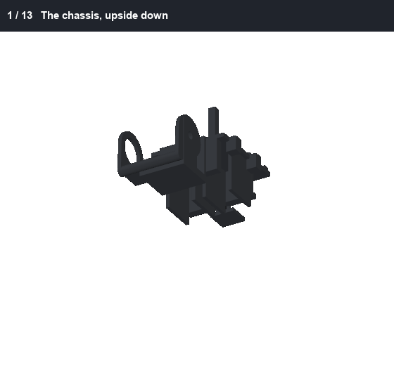

> 🔌 Each servo keeps its own lead, out through the window low in its tray's far end wall, to the PWM bonnet in the body. Leave a 30 mm loop at every joint it crosses, tied each side ([WIRING.md](WIRING.md)).

**Screws for this section:** 16 x M3 x 6 mm, 8 x M3 x 16 mm

1. The chassis, upside down
2. Plug in the cables, push in the hip yaw servos
3. 2 screws each, from the top *(4 x M3 x 6 mm, 2.5 mm hex)*
4. The lids and their screws *(4 x M3 x 16 mm, 2.5 mm hex)*
5. Press in the bearings
6. Horns on, servos at mid-range
7. The yaw brackets, 4 screws each, before the roll servos *(8 x M3 x 6 mm, 2.5 mm hex)*
8. Plug in the cables, slide in the hip roll servos
9. 2 screws each, from behind *(4 x M3 x 6 mm, 2.5 mm hex)*
10. The lids and their screws *(4 x M3 x 16 mm, 2.5 mm hex)*
11. Press in the bearings
12. Horns on, servos at mid-range
13. A 6 V BEC up into each side pocket, tied to its 2 arms, before the legs

## 6. Legs onto the hips

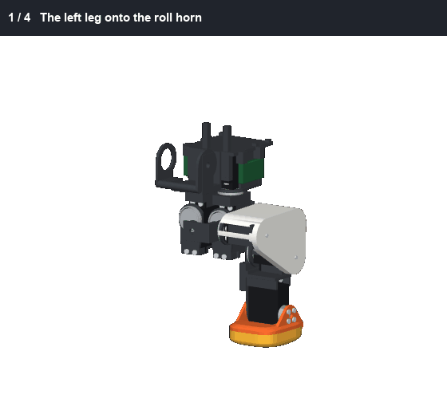

**Screws for this section:** 8 x M3 x 6 mm

1. The left leg onto the roll horn
2. 4 screws from the front *(4 x M3 x 6 mm, 2.5 mm hex)*
3. The right leg
4. 4 screws from the front *(4 x M3 x 6 mm, 2.5 mm hex)*

## 7. Neck column

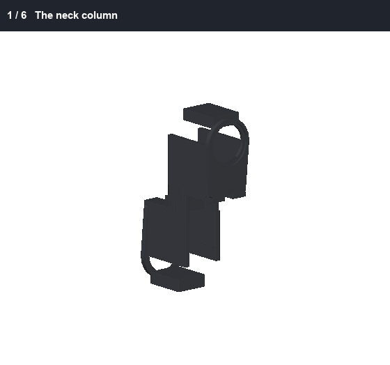

> 🔌 Each servo keeps its own lead, out through the window low in its tray's far end wall, to the PWM bonnet in the body. Leave a 30 mm loop at every joint it crosses, tied each side ([WIRING.md](WIRING.md)).

**Screws for this section:** 4 x M3 x 6 mm, 4 x M3 x 16 mm

1. The neck column
2. Neck servo in, horns on *(2 x M3 x 6 mm, 2.5 mm hex)*
3. Its lid, 2 screws *(2 x M3 x 16 mm, 2.5 mm hex)*
4. Head pitch servo in, horns on *(2 x M3 x 6 mm, 2.5 mm hex)*
5. Its lid, 2 screws *(2 x M3 x 16 mm, 2.5 mm hex)*
6. Press the rear bearings into the trays' floors

## 8. Neck and body shell

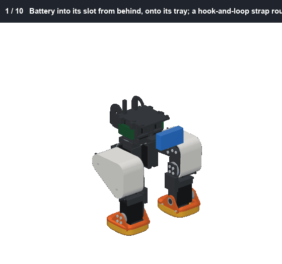

**Screws for this section:** 2 x M2 x 4 mm, 2 x M2 x 6 mm, 4 x M2.5 x 6 mm, 4 x M3 x 6 mm

1. Battery into its slot from behind, onto its tray; a hook-and-loop strap round both
2. The IMU on the top plate, double-sided tape
3. The Pi's 5 V converter on the plate beside it, foam tape
4. The Pi onto its 4 posts, microSD in, camera ribbon on, 4 screws *(4 x M2.5 x 6 mm, small Phillips)*
5. The PWM bonnet onto the Pi's GPIO header, then each servo's lead into its channel
6. The body shell, 2 screws, before the neck: the neck column is as wide as the body *(2 x M2 x 6 mm, small Phillips)*
7. The battery's two plugs out through the port in its back
8. The column down into the chassis fork
9. 4 screws on each horn *(4 x M3 x 6 mm, 2.5 mm hex)*
10. The rear hub through the fork into its bearing, 2 screws *(2 x M2 x 4 mm, small Phillips)*

## 9. Head yaw and roll

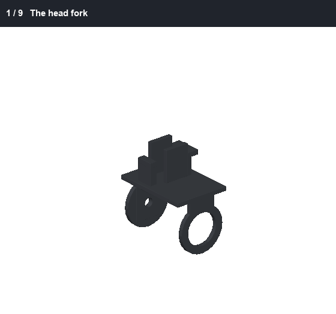

> 🔌 Each servo keeps its own lead, out through the window low in its tray's far end wall, to the PWM bonnet in the body. Leave a 30 mm loop at every joint it crosses, tied each side ([WIRING.md](WIRING.md)).

**Screws for this section:** 4 x M2 x 4 mm, 2 x M2 x 5 mm, 2 x M2 x 10 mm, 2 x M2 x 12 mm

1. The head fork
2. Head yaw servo in, 2 screws from under the bridge *(1 x M2 x 5 mm, small Phillips)*
3. The thin sheet, 2 screws *(2 x M2 x 10 mm, small Phillips)*
4. Bearing and horn
5. The yaw bracket, 4 screws, before its roll servo *(4 x M2 x 4 mm, small Phillips)*
6. Head roll servo in from the front *(1 x M2 x 5 mm, small Phillips)*
7. The rear bearing and rear horn, from behind
8. The lid, 2 screws *(2 x M2 x 12 mm, small Phillips)*
9. Bearing, horn and spacer

## 9b. The head frame and the beak servo

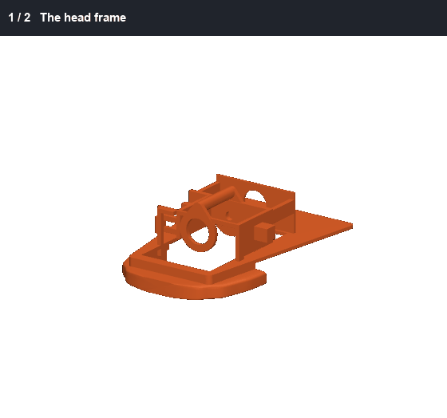

> 🔌 Each servo keeps its own lead, out through the window low in its tray's far end wall, to the PWM bonnet in the body. Leave a 30 mm loop at every joint it crosses, tied each side ([WIRING.md](WIRING.md)).

**Screws for this section:** 2 x M2 x 5 mm

1. The head frame
2. Beak servo in from the side, its horn out, servo at mid-range, 4 screws from inside (the roll servo blocks them later) *(2 x M2 x 5 mm, small Phillips)*

## 10. The jaw

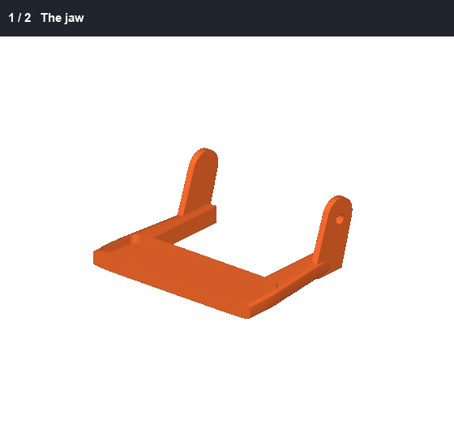

1. The jaw
2. Glue in its soft insert

## 11. The head

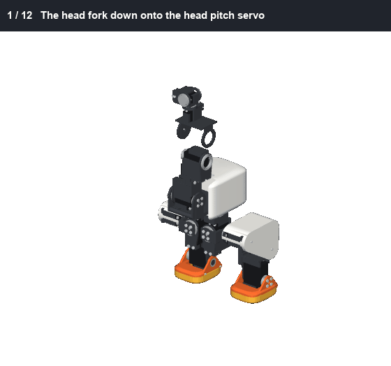

**Screws for this section:** 4 x M2 x 4 mm, 8 x M2 x 6 mm, 2 x M2 x 8 mm, 4 x M3 x 6 mm, 1 x M3 x 10 mm

1. The head fork down onto the head pitch servo
2. 4 screws on each horn *(4 x M3 x 6 mm, 2.5 mm hex)*
3. The rear hub through the fork into its bearing, 2 screws *(2 x M2 x 4 mm, small Phillips)*
4. The head frame, with its beak servo, down over the roll servo
5. 4 screws on each horn *(4 x M2 x 6 mm, small Phillips)*
6. The rear hub through the fork into its bearing, 2 screws *(2 x M2 x 4 mm, small Phillips)*
7. The jaw, up from below, its tab sliding onto the horn, 4 screws *(4 x M2 x 6 mm, small Phillips)*
8. The hood, down between the jaw's tabs
9. Open the jaw and glue in the soft mouth roof through the gap
10. The camera, its ribbon to the Pi, then glue in the face (the camera taped to its back), the eye ring and its iris
11. 2 screws up through the band into the hood's back *(2 x M2 x 8 mm, small Phillips)*
12. A 0.5 mm washer, and the hinge screw on the far side holds the jaw and the hood *(1 x M3 x 10 mm, 2.5 mm hex)*

## Wires

See [WIRING.md](WIRING.md). **Tie the ankle's wires up against its rail:** the shoe's ear passes close by them past 1 rad.
