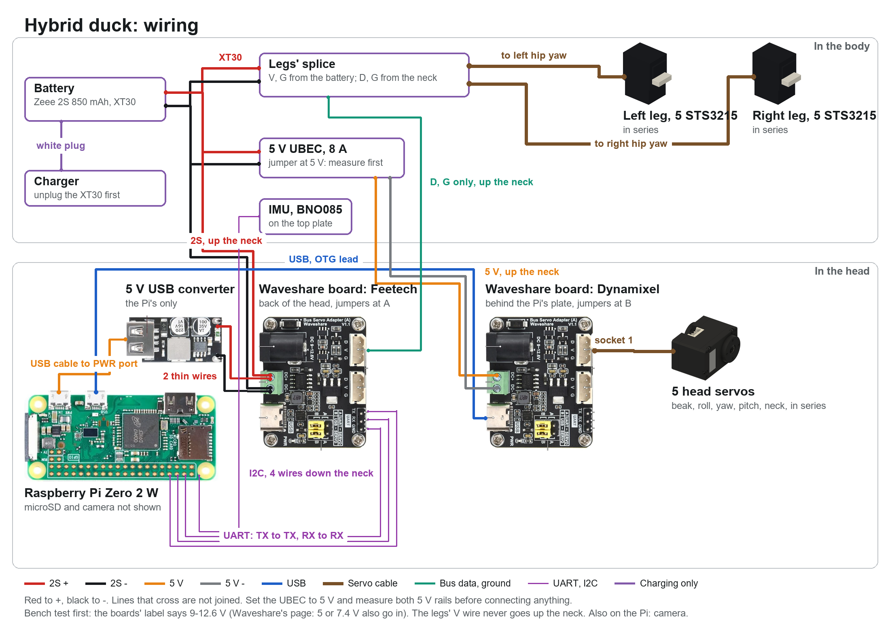
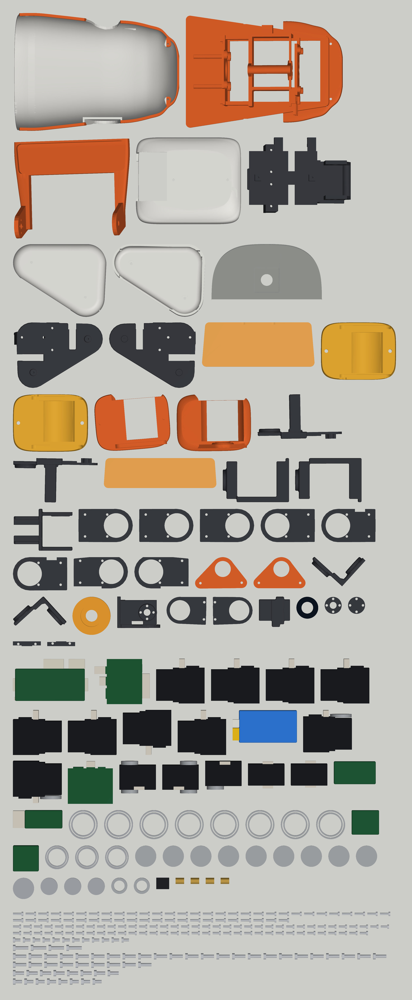

# Wiring the hybrid duck

Nothing here has been built. Connector positions for the STS3215 come from SO-101's mesh; for the XL330 from ROBOTIS's own model. **The walking policies in this repo took foot switches, which this duck no longer has: it needs retraining before it walks.** No training has been done on this version.

## Every part

Everything you'll handle, drawn from the model. Its counts are checked against the [BOM](BOM.md). Printed parts are the real Fusion bodies; bought parts are the model's shapes, not the makers' CAD.

The picture is drawn and checked from `spec/wiring_hybrid.json` by `python -I tools/wiring_diagram.py spec/wiring_hybrid.json docs/dynamixel/parts docs/wiring.png`: change the config, not the picture. Each wire's route and length, in its worst pose: [reports/wire_routes.md](../../reports/wire_routes.md), from `tools/wire_routes.py`.

## What changed, and why

| Was | Now | Why |
|---|---|---|
| FE-URT-1 for the Feetechs, U2D2 for the Dynamixels | The same Waveshare Bus Servo Adapter (A), twice | The U2D2 gives its servos no power, so its first cable had a splice; the board has terminals and sockets. Waveshare documents this board on a Pi Zero's UART. Two boards of one part, $4.99 each at Waveshare, against $17 and $47, and the U2D2 was sold out at ROBOTIS |
| 2 UBECs in the body, soldered 5 V to the Pi | 1 UBEC in the body for the head's servos; the all-Dynamixel's USB buck converter in the head for the Pi | 8 A was far more than the Pi needs. A USB plug in the PWR port, not a solder joint. 10 g less in all |
| 2 foot switches, 4 wires down the legs | none | Too much wire, and microduck doesn't use them |
| Pi's ports hidden in a box | USB edge up, every plug modelled, with room | No check can see a plug that isn't there |

**What was tried and left:**

- **One board, one wire, both servo makes.** Both are half-duplex TTL, so a board could drive both. Not done: the rails differ (5 V and 2S) and nobody has shown it works. A Dynamixel status packet can hold `FF FF` followed by anything, for instance a small negative current, which a Feetech can read as the start of a packet. A wrong packet would pass its 1-byte checksum 1 time in 256. In a walk's millions of packets, that is a servo moving by itself.
- **The Feetech board in the body**, so its 2 sockets feed the legs with no splice. The best answer, if it fitted: a board wants 42 x 33 x 12.6 mm, and the body's largest free space is about 15 x 8 mm in section. Growing the body loses microduck's proportions.
- **The head's servos on 2S with no UBEC**, as the all-Dynamixel's do. It would take out the UBEC and one power pair. Not done: that's past ROBOTIS's 6 V limit, with microduck's precedent only for the XL330, none for this neck's XC330. It's a choice for you: see below.

## Power

| Rail | From | Feeds | Worst case |
|---|---|---|---|
| Battery, 7.4 V nominal, **8.4 V full** | Zeee 2S 850 mAh 50C, an XT30 soldered on | the 10 STS3215s, through the legs' splice in the body; the UBEC; a pair up the neck to the Feetech board's terminals | 42 A from the pack (the STS3215s at stall). Walking current hasn't been measured |
| Servo 5 V | FEICHAO 8 A UBEC, in the left side pocket, jumper at 5 V | a pair up the neck to the Dynamixel board's terminals, then the XC330 and 4 XL330s through its socket | 7.7 A if all 5 stall (1.80 + 4 x 1.47 A, per ROBOTIS) |
| Logic 5 V | hiBCTR USB buck converter in the head, 2 thin wires from the Feetech board's terminals, USB cable to the Pi's PWR port | Pi Zero 2 W, IMU (through the Pi) | under 1.5 A |
| Board logic | Feetech board: its own regulators, from its 2S. Dynamixel board: over its USB-C | | |

**Measure before connecting anything:** the UBEC's jumper has a 6 V position, and the USB converter can give up to 12 V if something asks for fast charging.

**Keep the 2 positive rails apart.** The 2S and 5 V pairs go up the neck side by side. They share a ground. Their reds must never meet: mark them.

**A full pack is above the 7.4 V most sellers give for the STS3215** (one says 8.4 V). Open Duck Mini runs STS3215s on 2S; confirm yours on a single servo first.

**The bus boards are labelled DC 9-12.6 V.** Waveshare's product page says 5 V or 7.4 V can also go in, matching the servos. Bench test one on 5 V and one on a full 2S before fitting.

**The legs' V wire stays in the body.** Each leg's first lead carries that leg's current through a 5264 plug, about 3 A by its contacts, and 5 STS3215s can pull more at stall. If those plugs get warm, solder the hip yaw leads' V and G straight to the battery lead.

All the 2S joins are one star on the XT30 pigtail, in the same heat-shrink as the legs' splice: legs' V and G, the UBEC's input, the pair up the neck.

The UBEC is shut in the body shell, with up to 40 W of servo current through it at a stall: watch its temperature on the first long run. Nothing has measured it.

No power switch is designed in: unplug the XT30, which sits with the balance plug in the port at the rear left of the body. To charge, unplug the XT30 first, then use the balance plug.

## Signals

| From | To | How |
|---|---|---|
| Pi micro USB (the port marked USB), right-angle OTG lead | Dynamixel board, USB-C | both jumpers at B. The board stands on the back of the Pi's plate, as the all-Dynamixel's does. The Pi's USB edge faces up, under the hood. The OTG plug's cable leaves toward the microSD end, the PWR plug's toward the camera end, or they meet |
| Pi UART: pin 8 (TX), pin 10 (RX), pin 6 (ground) | Feetech board's TX, RX, GND pins | **TX to TX, RX to RX**, as Waveshare's page says. Both jumpers at A. 3 thin wires, over the frame, under the hood. On the Pi, turn the serial console off and give the UART to the pins (Bluetooth off) |
| Feetech board, socket 1 | legs' splice in the body | **data and ground only:** take the V wire out of the plug. Up the neck. Socket 2 is empty |
| Pi I2C: pins 3, 5, and 1 (3V3), 9 (ground) | IMU in the body | 4 thin wires down the neck |
| Dynamixel board, socket 1 | beak servo | a ROBOTIS lead. Socket 2 is empty. The sockets may need easing to take Dynamixel plugs: do it before fitting |
| Pi camera port, at the end of the board by the regulator | camera | 15 cm ribbon. Leave slack: the camera is on the hood, the Pi on the frame |

Solder the Pi's 7 wires before it goes on its plate. They leave from its bottom edge, round the microSD end, and behind the plate.

**Setting IDs:** on the bench, one servo at a time, through a board on USB (jumpers at B, on a laptop): Feetech's tool for the STS3215s, ROBOTIS's Dynamixel Wizard for the others.

## The chains

Each servo has 2 sockets, wired through, so each chain is one line.

- **Feetech:** left ankle -> knee -> hip pitch -> hip roll -> hip yaw -> splice <- right hip yaw <- ... right ankle. One bus, IDs 1-5 and 6-10, at 1 Mbps. The 2 hip yaw leads have a plug cut off and join at the splice.
- **Dynamixel:** Dynamixel board -> beak -> head roll -> head yaw -> head pitch -> neck. Its own bus, IDs 1-5. The 180 mm lead in each servo's box covers each link: 5 leads, 5 links.

Each STS3215's own lead, about 15 cm, covers each of its links. Longest: 118 mm wanted, hip roll to hip yaw.

## Where the wires go

| Servo or board | Sockets | Way out |
|---|---|---|
| Hip yaw | rear face, up through a window in the top plate | along the plate, under the shell, to the splice beside them |
| Hip roll | rear face, through a window in its tray | back, then out to the thigh, leaving slack for roll and yaw |
| Hip pitch, knee | rear face, through windows in the thigh plate, under the cover | a notch in the plate's top edge (from the hip) and its back edge (to the shin), to the cover's open inside |
| Ankle | rear face, through a window between the plate's 2 rails | **tie the wires straight up the rail.** The shoe's inner ear passes within 1 mm of the plug past about 1 rad, and would catch a loop |
| XL330, XC330 | in notches at the long edges of the rear face | out sideways; for the head roll and beak, through a groove in the plate against that side |
| Battery | XT30 and balance plug, at the end of the pack | in the port at the back; its tail along the side of the body, past the UBEC, up over the top plate |

**Through the neck, 10 wires:** the 2S pair and the 5 V pair (20 AWG), data and ground for the legs, 4 thin wires for the IMU. Out of the shell's neck slot, behind the neck column on the head's right side, up under the head's base, through its opening at the back. Across the neck pitch, head pitch and head yaw joints leave a loop for each. **The head yaw has +/- 2.5 rad, and winds:** leave about 45 mm there, and try it. Those loops are not modelled: tie them, and check with the power off.

**In the head:** the Feetech board is at the back of the head, on the plate behind the roll servo: sockets up, terminals down, toward the opening. The Dynamixel board's power pair runs forward along the base, on the left, under the beak servo.

Across each joint, leave a loop for its whole range. Then move every joint by hand, end to end, before powering up.

## What is not designed

- A power switch: the XT30 does it.
- Wire clips and exact lengths: the numbers above are straight runs, with 15 % and 30 mm added. Measure on the build.
- Speaker and microphone.

## TODO: review the head's voltage

**Chosen for now: 5 V, through the UBEC.** It stays inside ROBOTIS's 6 V limit, and the hybrid's parts and Fusion model are already built this way.

**Review and compare later: the head's servos on 2S, no UBEC.** It would take the UBEC (18 g, $19) and a power pair out of the neck, and give the head pitch XL330 almost twice its torque, as the all-Dynamixel's has. The XC330 at the neck would be running past its limit with no precedent; an XL330 there on 2S would give 0.96 N m, as much as the XC330 at 5 V, for $76 less and one less sold-out part. Expect a shorter life from any of them.

To compare: run one XL330 and one XC330 on a full 2S on the bench, measuring temperature and how long they last against the same servos at 5 V. The all-Dynamixel duck's XL330s run on 2S, so its first build adds evidence for the XL330 too.
